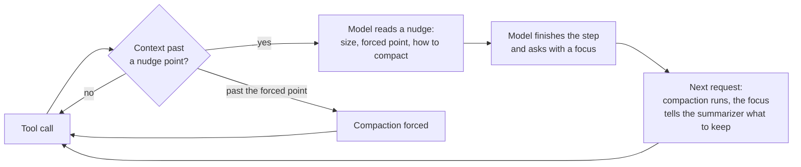

<div align="center">

# sub-agent-compact

**Smart auto-compact for Claude Code: a separate compaction point for every sub-agent, and self-compaction at a milestone the model chooses.**

[](https://docs.claude.com/en/docs/claude-code/plugins)
[](./CHANGELOG.md)
[](./LICENSE)
[](#development)
[](https://github.com/rezzminator/professor)

**34% cheaper** than a sub-agent that never compacts · **52% less context** re-sent on every request

</div>

```yaml
---
name: big-reader
description: Reads large files in full.
autoCompact:
  forceAt: 60%      # compacts here even if the model never asked
  nudgeFrom: 20%    # first nudge to reach a milestone and compact itself
  nudgeEvery: 10%   # one more nudge at each step past the first
  enabled: true     # false: never nudged or compacted automatically
---
```

<sup>Add `autoCompact` to any agent's frontmatter in `.claude/agents/*.md`. Every key is optional; a key left out takes the central default. See <a href="#per-agent-policy-frontmatter">Per-agent policy</a>.</sup>

---

Claude Code compacts the main chat and every sub-agent at one shared
auto-compact threshold. Long-running sub-agents therefore either re-send a
huge context on every tool call, or get compacted blindly in the middle of
their work.

**sub-agent-compact** gives each party its own compaction policy, and lets
the model decide *when* to compact.

- 🎯 **Per-agent auto-compact thresholds.** The main chat, each sub-agent
  type and each built-in (`general-purpose`, `Explore`) gets its own point,
  set in `settings.json` or in the agent's frontmatter.
- 🧠 **Self-compaction at milestones.** As the context grows, the model is
  nudged to finish the step in hand and compact itself. It picks the moment
  and names what the summary must keep.
- 🛟 **A forced point as the safety net.** A party whose model ignores the
  nudges is still compacted when it reaches its ceiling.
- 🪶 **Haiku is left to Claude Code.** For a Haiku party the plugin does
  nothing: no nudge, no hold, no forced point, no brief seated back after a
  compaction, and a `forward_handoff` or `handoff` call is refused unstored.
  Every compaction ask passes, and Claude Code's own protocol runs.
- 📜 **Every decision logged** to a JSONL file per session, when you want to
  see why a compaction ran or was held. Every line the plugin says lands there
  too, as a `said` row: errors always reach the screen and the log. Warnings
  and info go only to the logs while logging works; they fall back to the
  screen when neither log is available, or logging is off or failing.
  Tool replies and installed handoff text are product output, not diagnostics,
  and are unchanged. A
  main-chat compaction Claude Code ran without asking the plugin (its reading fell to half or less, with no
  `session.compact` in between) is logged as `compact-unseen` with the
  readings `before` and `after`; its stored handoff is dropped
  (`handoffDropped`) and its nudges start over. A `/clear` or a resume
  writes a `cleared` row and starts the main chat over.
- 🧾 **The log keeps its evidence.** Rows are only ever appended, under a
  lock, by every chat and sub-agent of the machine at once. Routine skips
  fold: the first of a streak is written, the rest become one `skips` row
  (`count`, `from`, `to`, `firstTokens`, `lastTokens`, `limit`) at the
  party's next decision, every 100 skips, and at session end, so a skip
  never evicts a compaction, nudge, handoff, error or start row. A session
  file over 8 MiB moves to `.1`. Rows queued at session end are written
  before the plugin exits, within Claude Code's short session-end bound; a
  row the bound cuts off is counted on the screen. An append that fails (an
  interrupt aborts the hook's run, a full disk) keeps its rows, at most
  2,000, for the next write; an append rejected after it wrote leaves a
  duplicate row, never a lost one, and one killed mid-row a torn line the
  retried rows start after. Rows still unwritten at session end, and
  any the 2,000-row hold let go, are counted on the screen and in a
  `decision-log-rows-lost` error row. Retention: once
  per session, after its first rows are written, the files of other sessions
  beside it (each with its `.1`) older than 14 days go, then all but the
  newest 200, this session's counted; one `find` reads every age, so only
  each file deleted costs a process. Only
  a `<uuid>.jsonl` file whose first line has a decision row's shape
  (`{"ts":"…","event":"…`) is a session's file, so retention treats the
  `logFile` folder as the plugin's own: keep it in a folder of its own.

## 📊 Benchmark

The job: one Sonnet 5 sub-agent renames an identifier across **24 Go files**,
Edit only, about **500 model requests**, with the same brief in every run.

| | No compaction | **sub-agent-compact** |
|---|---:|---:|
| **Cost** | $18.39 | **$12.20** |
| Cost per request | $0.036 | $0.024 |
| Mean context per request | 161k | 77k |
| Executor time | 29 min | 47 min |
| Compactions | 0 | 4, each at a milestone the model chose |
| Files exactly right | 24/24 | 23/24 |

**Where the saving comes from.** Every tool call re-sends the whole
context, so a sub-agent that never compacts pays for its whole history again
on each request. Self-compaction halved the mean context. That cut cache
reads from $16.32 to $7.59, a saving of $8.73, of which compaction gave back
$2.56 in re-caching, extra output and summaries.

The run also exposed a bug, since fixed: a stale reading right after one
compaction used up a nudge, and that stretch ran to 205k before the next one.
The fixed version hasn't been re-measured, so no figure is claimed for it.

## 🚀 Quick start

```sh
# 1. Turn on function hooks, and let Claude Code ask to compact from about 67k
export CLAUDE_CODE_ENABLE_FUNCTION_HOOKS=1
export CLAUDE_CODE_AUTO_COMPACT_WINDOW=100000

# 2. Install
claude plugin marketplace add rezzminator/sub-agent-compact
claude plugin install sub-agent-compact@sub-agent-compact
```

Both variables also work in the `env` block of `settings.json`. That's all
you need: with the defaults, the main chat is nudged from 20% of its window
and sub-agents from 20%, every 10% after that, and each is forced at 60%.

> **Early access.** This plugin is built on Claude Code's function hooks,
> an early-access surface that may change between releases. It is tested on
> Claude Code 2.1.282 and 2.1.283.

## 🧠 How it works



1. **Nudges.** After a tool call, once a party's context passes its first
   nudge point, the model reads one line after the tool's result: how full
   it is, where it will be forced, and how to compact itself. Another line
   follows at each step past the first. The nudges start over after every
   compaction.
2. **Asking.** The main chat calls the `compact` tool
   (`mcp__sub-agent-compact__compact`) with a `focus`: the plan or its
   file, what is done, what is left, the next step. A sub-agent whose
   definition has a `tools:` allowlist can't see a plugin's tool, so it
   writes `<compact-now>its focus</compact-now>` in a response that also
   calls a tool. A sub-agent whose `tools:` list lacks the forward handoff
   tool (or whose `disallowedTools` names it, or its server) is never nudged
   toward it.
3. **Running.** The request arms the party. The next time Claude Code asks
   to compact it, the plugin lets it through, and the focus becomes the
   summarizer's instructions. A party that never asks is held until its
   forced point, then compacted there.

With `handoffTool` on, the model hands off instead of asking, and no
summarizer request runs:

1. **Nudges.** The note after the tool's result says how big its context
   is, that every request re-sends all of it, what a handoff would cut it
   to, and what a handoff must hold. Once that result closes a step and
   work is still ahead, the handoff is its next call; with only its final
   answer left, it answers instead.
2. **Handing off.** The main chat calls the `handoff` tool
   (`mcp__sub-agent-compact__handoff`) with typed fields it fills while it
   still holds the context: `goal` (the user's intent, fixed values
   verbatim) and `next_step` (the exact first action) are required; the
   optional `done_verified`, `in_flight`, `files` (`path:line` anchors to
   reopen, never contents), `decisions`, `dead_ends`, `standing_rules` and
   `notes` are short lists or lines, and an empty one is left out. A missing
   required field comes back to the model as a tool error it reads on the
   spot. `load_on_wake` names skills or commands the model will need again;
   the plugin resolves each name at the call (an unknown name is refused
   then, not at install) and inlines it at install, except a skill the
   transcript shows was invoked, which is not inlined again (the model is
   told it invoked it, and to invoke it again if its text is gone). Only a
   regular file of at most 256 KiB is read. A
   sub-agent whose definition has a `tools:` allowlist can't see a plugin's
   tool, so it writes `<handoff>its handoff</handoff>` in a response that
   also calls a tool.
3. **Installing.** The plugin stores the handoff. The next time Claude Code
   asks to compact the party, the plugin answers the ask itself: the
   sub-agent's brief (verbatim, see below), then the handoff, then the
   results of any tool calls made beside it, then every message after the
   call, kept as they were. No summarizer request runs, so the handoff is
   the party's whole past, word for word. The main chat below Claude
   Code's own compaction point installs it when its turn ends. A party that
   never hands off is held until its forced point, then compacted there.

With both on, the `compact` tool and the `<compact-now>` marker still arm
the party, and the nudges name the handoff.

Guards keep this honest:
- A marker quoted in backticks, one in a final answer, or one in the main
  chat's text counts for nothing.
- A sub-agent that sends the marker alone would end its own run, because a
  response without a tool call is its final answer. The plugin refuses that
  stop once, and the agent carries on.
- A self-compaction or a handoff is refused below the party's first nudge
  point (`mainAutoCompactNudgeStart`, `subagentAutoCompactNudgeStart`),
  where it throws away more working context than it saves, and a handoff
  also when it is too thin: a `goal` or `next_step` under 20 characters, or
  a free-text or marker handoff under 200. The model is told why and
  carries on; the latest
  handoff a party passes is the one installed.
- A handoff is capped at 12000 characters (about 3k tokens): a longer one
  is refused with the size, and the model is told to keep anchors, not
  contents. A marker's text is held to the same minimum, maximum and
  nudge-point checks as a tool call's.
- A handoff whose call the plugin cannot find in the transcript at install
  time is not lost: the summarizer runs with the handoff as its
  instructions, and the handoff stays stored if the summarizer is skipped.
  A handoff the plugin's memory lost (a reload, a restart) is read back from
  the transcript's own `handoff` call before the compaction is judged.
- A person's `/compact` runs the summarizer as it always does; over a stored
  handoff it is logged and the model is told the handoff was dropped once
  the summary ran. A `/compact` that is skipped or interrupted leaves the
  handoff stored, and says so.
- Every failure a model can act on reaches the model: a notice (a refused
  marker, a skipped compaction, a handoff that was not installed) is read
  after the party's next tool result, the main chat's at its next prompt.
  Each install writes one visible log line naming the party and the size it
  cut. The tool failing to register is retried up to three times and, if it
  still fails, logged once with what the model can no longer do; with both
  `handoffTool` and `compactTool` off the plugin says so once.
- A compaction event whose trigger or transcript shape the plugin does not
  recognise (a Claude Code change) is treated as automatic and logged once
  by name, never read as absence. A Haiku-class party is left to Claude
  Code: its ask comes near 51k, below the 67k the plugin assumes for others
  (measured on 255 non-Haiku sub-agent asks, median 65.2k, p90 67.0k).
- A limit past the party's real window is clamped to Claude Code's ask
  point for that window (said once per party type); decision rows carry the
  clamped `limit`, and `limitSet` beside it when it was clamped. The main
  chat's window is read again when its model changes (`/model`), logged as
  `window-changed`. An automatic ask that comes again after the last one
  was skipped (Claude Code's "prompt is too long" recovery) passes, as
  `unanswered`, within the turn, until a response arrives (a reading, or a
  step that asks for tools); once that turn ends, the next turn's ask is
  held again.
- You can always call a self-compaction or a handoff off. A message you
  send cancels a compaction the main chat armed or a handoff it stored, and
  the model is told not to ask or hand off again until your ask is done. An
  interrupt (Esc or Ctrl+C) while one is armed or stored, or a compaction
  that is skipped or fails, also drops it, so it never fires on the next
  request instead. A notification
  or a message from another chat cancels nothing.
- The main chat's nudges tell its model that a person waiting on an answer
  comes first: it never compacts or hands off while you wait.
- A Workflow run's agents get the sub-agent policy like any other: their
  type comes from Claude Code's `SubagentStart` hook, since
  `$.agent.list()` never names them.
- An engine loop that is not one of the session's sub-agents (a fork
  Claude Code runs itself) is left to Claude Code's own point: never nudged,
  armed or held.
- **A sub-agent keeps its brief.** Claude Code replaces a sub-agent's first
  message, the prompt its parent passed, with the summary, so exact paths,
  acceptance rows and standing rules would survive only as the summarizer's
  paraphrase. After each of its compactions the plugin seats that prompt
  again, verbatim, as the message right after the summary
  (`subagentKeepBrief`, on by default; the main chat is untouched). The
  seated message opens with one marker line, so a later compaction finds
  it: the sub-agent holds exactly one copy however often it compacts.
  Past 64k tokens (characters / 4, the bound Codex keeps user messages to)
  the head up to that size is kept, followed by one line saying where the
  brief was cut. A skipped compaction is left as it is; an error in seating
  is logged and the compaction stands as Claude Code made it.
- A lookup that fails is logged, and the compaction goes through. The
  plugin never holds a compaction because of its own error.

### Forward handoff

With `forwardHandoffTool` on, the main chat and every sub-agent a policy governs can call `forward_handoff` at a moment they pick (never mid-edit). The installed text is one header line, then only the blocks that hold something, then the model's frontier with `Next` last:

| Block | Source | Cap |
|---|---|---|
| `User` | the last 25 prompts a person or a parent wrote, verbatim, whitespace collapsed, the latest marked; a slash command is `/name args` (its body is in its `Skill` block), an image is `[image <absolute path>]`; what the harness writes (tool-loaded notes, image notes, reminders, notifications, the note after an output cut, a sub-agent's message back, a chat's reply footer) is left out. A chained handoff reads the earlier one's prompts from its `record.json`, never from the text | about 8k tokens, the oldest cut first |
| `Skill <name>` | each skill and command the earlier wake carried (its `record.json` `skills`; for a record without them, its `Skill` blocks by name), then each invoked since, once, reloaded from disk (the directory Claude Code printed for it, then the project, user and plugin directories) minus `drop_skills`, frontmatter stripped; one that could not be read is named and not carried on | about 3k tokens each, 12k total |
| `Files` | `E`/`R`/`C path` per file the tool calls edited, read or created, newest first, every path absolute, plus subdirectory `CLAUDE.md` files the session picked up | 15 lines |
| `Load <path>` | the `load_files` the model named, read at handoff time, a `lines` range exactly; a path the `Read` tool would not be allowed to read without asking is not read, and named in `Unresolved` | about 3k tokens each, 12k total |
| `Plan`, `Tasks`, `Running`, `Git`, `Paths` | the plan, the latest todo or task state, background shells, sub-agents, monitors, wakeups and crons still running (the engine's own in-flight list from the last turn's end, plus calls since), a git line (branch, head, dirty files) per repository the work touched — those of the files made or edited, else of the files read, newest first, a linked worktree or submodule as its own, each named by its root; the session directory's, unnamed, when the files name none — and a last line saying it was read when the handoff was stored, right before the wake, the transcript (found by its session id) with the line of the cut, the previous forward handoff and the saved files | one line per item; `Git` names 3 repositories and counts the rest; `Paths` is one line |
| `Unresolved` | a skill or file that could not be read, an unknown `drop_skills` name, a failed git or transcript read; ends with the `look_back` hint and the call's shape | one line each |
| `Objective`, `Done`, `Remaining`, `Blocked`, `Findings`, `Next` | the model's arguments; an over-limit field is trimmed and marked `[trimmed]`, never refused; a list sent as a string is read as its items (a JSON array's, else one line's inline `1) … 2) …` numbering, else its lines without bullets or numbers); a missing required field returns one error naming it, each field of the wrong type with what it got, and the call's shape | per field, in characters: `objective` 600, `next` 400; items: `done` and `remaining` 15 of 200, `blocked` 10 of 200, `findings` 15 of 300 |

The tool is deferred, so a model that woke from a handoff sees only its name: the context nudge toward it, the reply to a call missing a required field and the wake's `Unresolved` block each state the call's whole shape, every field with its type (lists as arrays of strings) and its limit. The reply to a stored call gives its size by block, then names each field cut to fit with its characters (and items) before and after, that the uncut arguments are in `args.json`, and how to keep what was cut (send the field again within its limit, longer detail in a file named in `load_files`); each list that arrived as a string and how many items it became; and each skill or `load_files` entry the wake does not hold, and why. A call again in the same turn replaces the stored one. A Haiku party's call, or one from a sub-agent whose `tools:` lacks the tool, is refused with that reason before its arguments are read. A party that woke from a forward handoff and is still below its first nudge point is refused, as a second handoff there saves nothing, unless a message the person wrote since the wake names compacting or a handoff (`compact`, `compaction`, `handoff`, `hand off`, `forward_handoff`) with no negation before it in its clause: the word is read, not the intent, so a question about a compaction counts, while a name such as `auto-compact` does not, nor does a context that holds no wake; the refusal says so, and that their `/compact` compacts at once.

Every call is saved under `$HOME/.local/state/sub-agent-compact/forward-handoff/<session>/<n>/` (`<session>/agent-<id>/<n>/` for a sub-agent; without `HOME`, under `<Claude config directory>/sub-agent-compact/forward-handoff/`): `args.json` (the arguments as received), `wake.txt` (the installed text, literally) and `record.json` (the chars and estimated tokens of every block and of the total, the context before and after, the skills and commands its wake carried, and the install check that each block landed, made at the first request after the install against what the session then holds). The path is logged and named in the `Paths` block. The `HOME` root survives a `CLAUDE_CONFIG_DIR` or account switch, so the chain holds; records an earlier version kept under the config directory are still read, and numbering continues past them. A handoff stored before a plugin reload is installed from these files at the next compaction, as long as its call still stands in the transcript and no person's message came after it. A sub-agent's relative shell writes are placed in the directory it was spawned in, not where the main chat's shell is at handoff time. With neither `HOME` nor a Claude config directory, or when the session's directory cannot be listed, nothing is saved and the tool's reply says so. Results of tool calls made in the same response as `forward_handoff` are kept in a message of their own, before the installed text. Carried text cannot forge the structure: a line that reads as a block label, an item marker or the header gets a backslash in front.

### Look back

`look_back` is always available to the main chat and every sub-agent. It searches only the caller's own transcript before its latest compaction, including a forward handoff. Supply `why` (what the compaction lost) and `query` (all words must appear in one entry, case-insensitive; double quotes keep a phrase whole). Results are numbered, newest first, with readable snippets. Fetch an exact entry with `entry: N` instead of a query; entries already in context are refused.

Every call is a counted compaction miss: the decision log records `look-back` and the one line explaining what was missed when `logFile` is configured; plugin errors always reach the screen, while caller-input warnings and routine notices reach it only when neither log is available, or logging is off or failing. The tool reply is always returned to the caller. Manual `Read`, `Grep` or `Bash` calls naming the caller's transcript are also logged as `look-back-manual`, the same way, without changing the call. No compaction yet, no matching entry, and lookup failures have distinct replies; with no compaction yet the reply says so before any argument is checked. Task notifications (a child's result), other attachments, `system` and `summary` entries are searchable; an attachment with no text field is shown raw, and a queued prompt is read as one. Claude Code's own bookkeeping entries (queue operations, request copies, titles, modes, links, file history, cost, a `system` entry without text) are skipped without a note; an entry of any other type it cannot read makes the call an error naming it, the hits still shown. `entry: null` or `query: null` is read as absent. The caller's own `forward_handoff` calls and their replies rank below every other hit.

Search keeps the newest 200 raw candidates, re-checks the words against readable text, and returns up to 20 hits / 12k characters; an entry fetch keeps up to 24k characters with a cut marker. Tool results name their tool when its call can be found; unavailable names and unsupported transcript shapes are explicit. Missing details beyond these bounds need a narrower query or an entry fetch.

## ⚙️ Configuration

### Central options

Every option is an environment variable, `SUB_AGENT_COMPACT_` plus the option in
upper snake case (the table's second column). Set them in the shell that
starts Claude Code or in the `env` block of `settings.json`. There is no
plugin configuration: the plugin declares no `userConfig`, needs no
`pluginConfigs` entry and has no `/config` screen. An unset, empty or blank
variable is absent and the default applies.

A **size** is a percentage of the model's own window (`"10%"`), an integer,
or a number with a k/m suffix (`"150k"`, `"0.6m"`). A flag variable is `1`,
`0`, `true` or `false` in any case; a directory list is comma- or
newline-separated; the log file is an absolute path. A bad value is an error named by
its variable on the screen and in the log; the default is used, never ignored silently.
A variable that could not be read is named the same way and its default is used.

**Migrating from 0.7.** Values under
`pluginConfigs["sub-agent-compact@sub-agent-compact"].options` are no longer
read. If that object is not empty, the plugin reports an error once on the
screen and in the log, naming its keys, and applies none of them. Move each value to its variable
(`"mainAutoCompact": "600k"` becomes `SUB_AGENT_COMPACT_MAIN_AUTO_COMPACT=600k`;
`"forwardHandoffTool": true` becomes `SUB_AGENT_COMPACT_FORWARD_HANDOFF_TOOL=1`),
then delete the `pluginConfigs` entry.

`SUB_AGENT_COMPACT_PROBE_DIR` is not an option: only the host probe
(`npm run probe:installed`) reads it, to find the installed copy it checks.

| Option | Environment variable | Default | Meaning |
| --- | --- | --- | --- |
| `mainAutoCompact` | `SUB_AGENT_COMPACT_MAIN_AUTO_COMPACT` | `60%` | The main chat's forced point. |
| `mainAutoCompactNudgeStart` | `SUB_AGENT_COMPACT_MAIN_AUTO_COMPACT_NUDGE_START` | `20%` | The main chat's first nudge. |
| `mainAutoCompactNudgeEvery` | `SUB_AGENT_COMPACT_MAIN_AUTO_COMPACT_NUDGE_EVERY` | `10%` | The step between the main chat's nudges. |
| `mainAutoCompactEnabled` | `SUB_AGENT_COMPACT_MAIN_AUTO_COMPACT_ENABLED` | `true` | Off: the main chat is never nudged or compacted automatically; its own request still runs. |
| `subagentAutoCompact` | `SUB_AGENT_COMPACT_SUBAGENT_AUTO_COMPACT` | `60%` | A sub-agent's forced point, unless its definition sets its own. It covers built-ins such as `general-purpose` and `Explore`. |
| `subagentAutoCompactNudgeStart` | `SUB_AGENT_COMPACT_SUBAGENT_AUTO_COMPACT_NUDGE_START` | `20%` | A sub-agent's first nudge. |
| `subagentAutoCompactNudgeEvery` | `SUB_AGENT_COMPACT_SUBAGENT_AUTO_COMPACT_NUDGE_EVERY` | `10%` | The step between a sub-agent's nudges. |
| `subagentAutoCompactEnabled` | `SUB_AGENT_COMPACT_SUBAGENT_AUTO_COMPACT_ENABLED` | `true` | Off: sub-agents are never nudged or compacted automatically; their own requests still run. |
| `subagentKeepBrief` | `SUB_AGENT_COMPACT_SUBAGENT_KEEP_BRIEF` | `true` | On: after each compaction a sub-agent's brief is seated again verbatim right after the summary. Off: the summary alone stands for it. |
| `forwardHandoffTool` | `SUB_AGENT_COMPACT_FORWARD_HANDOFF_TOOL` | `false` | On: every party gets the `forward_handoff` tool (see [Forward handoff](#forward-handoff)). Code carries the user messages, skills, file trail, plan and tasks, running work and git state; the model writes only its frontier. Installed verbatim when its turn ends. |
| `handoffTool` | `SUB_AGENT_COMPACT_HANDOFF_TOOL` | `false` | On: models get the `handoff` tool. Its typed fields (`goal` and `next_step` required) are rendered to short markdown sections that replace the model's whole conversation so far, installed with no summarizer request; what it does after the call is kept. |
| `compactTool` | `SUB_AGENT_COMPACT_COMPACT_TOOL` | `true` | On: models get the `compact` tool (hidden while `forwardHandoffTool` is on: the forward handoff replaces it), whose focus a summarizer turns into a summary, and `<compact-now>` markers count; while `handoffTool` is also on, the nudges name the handoff. Off: no `compact` tool, and `<compact-now>` markers count for nothing. |
| `agentDirs` | `SUB_AGENT_COMPACT_AGENT_DIRS` | empty | Comma-separated extra directories of agent definitions. Blank items are dropped. |
| `logFile` | `SUB_AGENT_COMPACT_LOG_FILE` | empty | Absolute path of the JSONL decision log. Each session writes its own file: `decisions.jsonl` becomes `decisions.{session-id}.jsonl`. Empty uses `$PLUGIN_LOG_DIR/sub-agent-compact/decisions/{session-id}.jsonl` when that variable is set, otherwise decision logging is off. A relative path is named as invalid and falls back to that default. |

### Logs

Errors, warnings and info append JSONL rows to `$PLUGIN_LOG_DIR/sub-agent-compact/{errors,warnings,info}.jsonl`. With the variable unset, they use `$HOME/.local/state/sub-agent-compact/logs/`. Each plugin process's decision log gets one `start` row; after a `/clear` or a resume the new session id's file carries none. Rows name the event, component and session; diagnostic details never include handoff or transcript bodies. Rows are bounded to 4096 bytes, new directories and files are private, and a level file over 20 MiB moves to `.1` with a `log-capped` warning. A failed log write reports its directory and error once per failing streak without changing compaction or tool results.

Each diagnostic is one level row: a line said with its diagnostic row is written once, at the level said. A failing plugin log is named once per failing streak on screen and as a `plugin-log-failed` decision row; a failed decision-log session lookup as a `decision-log-session-error` error row, a failing decision-log write as a `decision-log-write-error` error row (its rows kept for the next write), and a failed cleanup of old decision logs as a `decision-retention-failed` warning row in both logs. Registering the tools holds a turn at most 5s; past it a `tools-timeout` warning says registration goes on, and its late finish is a `tools-late` row (`ms`, `tools`). An install's after-size counts the messages only, as its line says (`250k -> 6k tokens in messages (system prompt and tools not counted)`) and its row and the forward handoff's `record.json` (`tokensAfterScope: "messages"`); the next request reads the whole. The level files rotate under a lock shared by every session. Option keys the plugin does not know are named in one line; a nudge start at or past the forced point in the same unit is named and kept.

Resolver skips and failures are logged once per distinct path per plugin session (plugin-folder discovery failures use the plugin identity until its path is known), even after the policy cache expires. A listed `.md` link to anything other than a regular file, including a dangling link, is skipped and written at warning level. All warning- and info-level diagnostics stay off screen while a log keeps them; with neither log available, or logging off or failing, they fall back to the screen. A failing plugin log's own notice always stays visible. Errors always reach the screen and the log.

Broken settings (including ignored legacy options), failed tool registration, unavailable handoff nudging or timers, missing HOME access, failed plugin-skill discovery, unreadable or incomplete handoff installs and checks, failed brief seating or sub-agent stop handling, an incompatible native window and missing token readings are errors, not warnings. Safe fallbacks, deliberate tools-off settings, registration still in progress, retention failures and bounded or deferred work remain warnings. Tool replies, installed handoffs and model-facing context are unchanged.

Screen notices and the per-session decision log stay separate. An explicit `logFile` always wins; only the blank default follows `PLUGIN_LOG_DIR`. With neither `PLUGIN_LOG_DIR` nor `HOME`, the screen reports that plugin logging is off.

```json
{
  "env": {
    "CLAUDE_CODE_ENABLE_FUNCTION_HOOKS": "1",
    "CLAUDE_CODE_AUTO_COMPACT_WINDOW": "100000",
    "SUB_AGENT_COMPACT_MAIN_AUTO_COMPACT": "600k",
    "SUB_AGENT_COMPACT_SUBAGENT_AUTO_COMPACT": "60%",
    "SUB_AGENT_COMPACT_SUBAGENT_AUTO_COMPACT_NUDGE_START": "20%"
  }
}
```

### Per-agent policy (frontmatter)

Give one agent its own policy under `autoCompact` in its definition. Every
key is optional, and a key left out takes the central `subagent*` value:

```markdown
---
name: big-reader
description: Reads large files in full.
autoCompact:
  forceAt: 60%      # compacts here even if the model never asked
  nudgeFrom: 20%    # first nudge to reach a milestone and compact itself
  nudgeEvery: 10%   # one more nudge at each step past the first
  enabled: true     # false: never nudged or compacted automatically
---
You read files...
```

- A bare `autoCompact: 200k` is shorthand for `autoCompact.forceAt`.
- `enabled: false` suits an agent whose context must stay verbatim. Past
  its window it fails the way Claude Code does with auto-compact off.
- **Where the plugin looks** for a sub-agent's definition, by its type:
  `<cwd>/.claude/agents/<type>.md`, then `~/.claude/agents/<type>.md`, then
  each `agentDirs` entry. After those, it takes any file whose frontmatter
  `name:` matches.

### Model windows

Percentages are of each model's own window. The main chat's comes from
Claude Code. A sub-agent's comes from its model id: Haiku 4.5 and older 200k, Haiku 5.5, Sonnet 5 and
any `[1m]` model 1M, a model that is not Claude (a GPT model behind a
gateway) Claude Code's 200k default, and any other Claude model the main
chat's window.

### The window rule

A plugin can hold a compaction back, but it can't make Claude Code ask
sooner. Claude Code asks to compact a party only once it nears
`CLAUDE_CODE_AUTO_COMPACT_WINDOW`: about 33k below that value, measured as
about 67k for `100000`. So **set the window so Claude Code asks at or below
your smallest nudge point.** `100000` suits the defaults. A request a model
makes below that point waits until the party reaches it.

Letting a plugin start a compaction for any sub-agent from code would remove
this rule. It is requested upstream in
[anthropics/claude-code#91870](https://github.com/anthropics/claude-code/issues/91870#issuecomment-5848066352).

## ❓ FAQ

<details>
<summary><b>How do I set a different auto-compact threshold for sub-agents in Claude Code?</b></summary>

Install this plugin and set `subagentAutoCompact` (for all sub-agents) or
`autoCompact.forceAt` in one agent's frontmatter. Claude Code's own
`CLAUDE_CODE_AUTO_COMPACT_WINDOW` and `autoCompactWindow` apply to the whole
process, the main chat and every sub-agent alike
([#90347](https://github.com/anthropics/claude-code/issues/90347)).
</details>

<details>
<summary><b>Why do my sub-agents cost so much?</b></summary>

Every tool call re-sends the whole context. A sub-agent that runs for a few
hundred tool calls without compacting pays for its entire history on each
one. In the benchmark above, that is the difference between $18.39 and
$12.20.
</details>

<details>
<summary><b>Can Claude compact itself when it decides to?</b></summary>

Yes, that's the self-compaction feature. The main chat calls the `compact`
tool. A sub-agent writes `<compact-now>focus</compact-now>` alongside its
next tool call. In both cases the focus tells the summarizer what to keep. It
only arms once the context has passed the first nudge point.
</details>

<details>
<summary><b>Can I keep the main chat large and the sub-agents small, or the other way round?</b></summary>

Yes. The main chat's and the sub-agents' policies are independent, and each
agent type can override the sub-agent policy in its frontmatter.
</details>

<details>
<summary><b>Why doesn't the PreCompact hook work for this?</b></summary>

The classic `PreCompact` hook fires for a sub-agent's compaction without the
agent's id, so it can't tell which party is compacting
([#91910](https://github.com/anthropics/claude-code/issues/91910)). Function
hooks carry `agentId` on `session.compact`, which is what this plugin
decides on.
</details>

<details>
<summary><b>Does it work in headless mode (<code>claude -p</code>) and the Agent SDK?</b></summary>

Sub-agent compaction and self-compaction do. Compacting the main chat
between turns needs an interactive session: in `-p`, Claude Code 2.1.283
rejects it, and the plugin logs that and carries on.
</details>

<details>
<summary><b>What is the "not compacted · main 311k/600k" notice?</b></summary>

It appears each time the plugin holds a compaction Claude Code asked for: the
party, its context now, and where it will be compacted. Claude Code draws
every held compaction as a notice, and plugins have no way to hold one
silently yet, so the plugin keeps the line as short as it can.
</details>

## 🛠️ Development

```sh
npm install
npm test              # unit tests for plugins/sub-agent-compact/src/
npm run typecheck
npm run validate:plugin
npm run probe:installed   # with SUB_AGENT_COMPACT_PROBE_DIR=<installed plugin directory>: does that copy register forward_handoff from its environment variable alone?
```

Work lands on `develop`; `main` holds only releases, and each one is tagged `sub-agent-compact--vX.Y.Z` with its notes in [CHANGELOG.md](./CHANGELOG.md). Pull requests go to `develop`.

`plugins/sub-agent-compact/hooks/sub-agent-compact.ts` is a thin adapter over `plugins/sub-agent-compact/src/`:

| Module | Role |
| --- | --- |
| `limits.ts` | Sizes and the `SUB_AGENT_COMPACT_*` variables, parsed into a policy per party |
| `frontmatter.ts` | Agent frontmatter, one level of nesting |
| `agents.ts` | Resolves an agent type to its policy |
| `window.ts` | Model windows and Claude Code's ask point |
| `nudge.ts` | Nudge levels and text, the `<compact-now>` marker, the compact tool's reply |
| `handoff.ts` | The handoff tool's description and typed input, its validation and rendering to markdown, refusals, `<handoff>` marker and nudge, and the install that answers a compaction with the handoff and every message after it |
| `wake.ts` | `load_on_wake`: resolves skill and command names to files, refuses a path that is not a regular file or is past 256 KiB, strips frontmatter, skips invoked skills, caps the inlined text |
| `bounded.ts` | Bounds a promise with a timer passed in (the hooks have no `setTimeout`): tool registration holds a turn at most 5s |
| `brief.ts` | Seats a sub-agent's brief back after the summary, once, up to 64k tokens |
| `parties.ts` | Per-party state: readings (a base counts only from the session's first request, the main chat's also its first prompt), the armed focus, nudges sent, a refused stop, notices waiting for the model |
| `decide.ts` | The decision for one compaction request |

## 🎓 Built with Professor

sub-agent-compact is built and maintained with [Professor](https://github.com/rezzminator/professor), a fleet controller and discipline layer for Claude Code, Codex and OpenCode: chats that message each other, agents held to the project's rules, and gated releases. This plugin came out of it: Professor runs long orchestrations of sub-agents, and their context bills are why per-agent compaction exists.

## License

MIT

<sub>Keywords: Claude Code sub-agent compact · subagent auto-compact · smart compact · per-agent auto-compact threshold · autoCompactWindow per agent · CLAUDE_CODE_AUTO_COMPACT_WINDOW · context window management · context compaction · self-compaction · Claude Code plugin · function hooks · Claude Mods · multi-agent orchestration token cost</sub>
