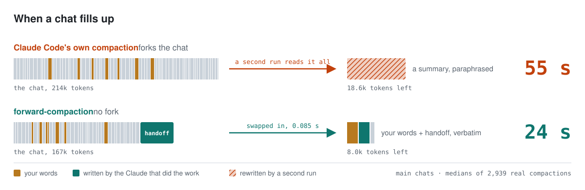
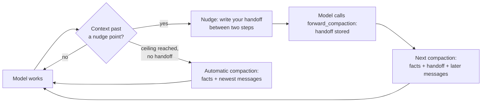

<div align="center">

# forward-compaction

**Claude Code compaction without the wait. The model writes its own handoff while it still remembers everything, so your exact words carry through.**

[](https://docs.claude.com/en/docs/claude-code/plugins)
[](./CHANGELOG.md)
[](./LICENSE)
[](#development)
[](https://github.com/rezzminator/professor)

</div>

<p align="center">
  <picture>
    <source media="(prefers-color-scheme: dark)" srcset="docs/assets/flow-dark.svg">
    
  </picture>
</p>

<p align="center"><sub>Main chats, medians of 2,939 real compactions over 30 days to 2026-10-29; the full numbers are in <a href="docs/field-medians.md">docs/field-medians.md</a>. For sub-agents native is faster (21.5 s vs 28.7 s).</sub></p>

## Why

When a Claude Code chat fills its context, Claude Code compacts it. The chat stops, a second request re-reads the whole conversation and writes a summary, and the chat carries on from that summary. This has two costs:

- **You wait.** A main chat waits 55 seconds at the median and 95 at the 90th percentile, every time it compacts.
- **Your words become a paraphrase.** Your instructions, a sub-agent's brief, and what is done and what comes next are all retold by a request that never did the work.

forward-compaction turns this around. As the context grows, the model is told how full it is. At a clean point between steps it calls one tool and writes its own handoff: the goal, your rulings, what is done, what is left, and the next action. At the next compaction the plugin swaps the old conversation for that handoff in under a tenth of a second, and no summarizer runs.

## What you get

- **Faster main-chat compactions.** The median is 24.2 s instead of 54.9 s: the time the model spends writing its handoff, plus 0.085 s to install it.
- **Less context left behind.** About 8k tokens remain instead of 18.6k, so every later request carries less.
- **Your words, verbatim.** Your ten newest messages, every answer you gave to the model's questions, and the standing orders it recorded from you ("never push without asking") come through word for word.
- **Work in flight survives.** The messages after the handoff call stay exactly as they were. The files touched, the shell commands run and the task list come along too, and the skills in use as a list to load again, so a skill's text costs nothing until it is needed.
- **Every sub-agent too.** Each sub-agent compacts the same way and keeps its own brief.
- **A safety net.** A chat that never writes a handoff is compacted automatically at a ceiling, keeping your messages and its newest work.
- **A way back.** `look_back` searches the chat's own transcript from before the compaction for an exact detail the handoff left out.

## Benchmark

One scripted ten-turn chat, run five times each on Claude Code's native compaction, on forward-compaction, and on forward-compaction with the fork option (`FORWARD_COMPACTION_MAIN_FORK=1`), on 2026-11-24 and 25: Sonnet 5.5 (`claude-sonnet-5-5`) at medium effort, Claude Code 2.1.331, no other plugin loaded. Both forward-compaction columns ran with `CLAUDE_CODE_AUTO_COMPACT_WINDOW=100000` and the native column with `143000`, so that all three compact at about the same context size (see the first note under the table). The first turn states four rules and the second a note to keep word for word; nine turns each read two record files and summarize every crate in them; the fifth turn changes one rule; the last turn forbids opening any file and asks for every crate's item and shelf and the total weight. Every figure comes from the runs' own records: each API request's usage and duration, each compaction's boundary record, and the files the chat wrote, scored against the scenario's truth.

| Median (p90) of 5 runs | Native compaction | forward-compaction | forward-compaction, fork option |
| --- | --- | --- | --- |
| Compactions in the run | 3 | 3 | 3 |
| Time one compaction stalls the chat | 17.4 s (20.3 s) | **5.6 s** (7.3 s) | 6.6 s (8.9 s) |
| Context when it started | 113.6k tokens (116.6k) | 120.2k (120.8k) | 119.2k (120.1k) |
| Context of the first request after | 36.1k tokens (62.5k) | **28.8k** (29.5k) | 39.5k (40.4k) ¹ |
| Tokens written per compaction | 3.0k (3.6k) | **768** (941) | 843 (1.2k) |
| Cost of one compaction | $0.153 ($0.263) | **$0.035** ($0.037) | $0.083 ($0.087) ¹ |
| Whole run: wall time | 4.0 min (4.1 min) | 3.5 min (3.6 min) | **3.4 min** (3.5 min) |
| Whole run: requests | 33 | 33 | 33 |
| Whole run: input · cache read · cache write · output tokens | 86.3k · 1964.7k · 316.3k · 17.0k | 1.4k · 2095.1k · 295.8k · 10.8k | 10.6k · 2370.5k · 296.7k · 10.3k |
| Whole run: cost | $1.80 ($1.82) | **$1.50** ($1.51) | $1.55 ($1.56) |
| Crate items recalled at the end | 133 of 180 | **180 of 180** | **180 of 180** |
| Crate shelves recalled at the end | **24 of 180** | 0 of 180 | 0 of 180 |
| User's rules obeyed after a compaction | 110 of 110 | 110 of 110 | 105 of 105 |
| Changed rule obeyed after a compaction | 16 of 16 | 15 of 15 | 15 of 15 |
| User's note quoted back word for word | 5 of 5 runs | 5 of 5 runs | 5 of 5 runs |
| Files re-read after a compaction | 0 | 0 | 0 |
| Final answers complete, total weight right | 1 of 5 runs | **5 of 5 runs** | **5 of 5 runs** |

Cost is every API request at Anthropic's list prices for the model, USD per million tokens: input 2, output 10, cache read 0.1, cache write 2.5 (5 minutes) and 4 (1 hour). One compaction's cost is the requests that wrote it plus the uncached input and cache write of the first request after it.

- **The same compaction point.** One window setting does not make the two compact at the same point: at a 100k window Claude Code's own compaction starts at about 77k tokens, while forward-compaction holds that ask until a frontier is stored and compacts at about 120k. The native column therefore ran with a 143k window, which starts its compactions at about 114k, three a run like forward-compaction's. At the 100k window native compacted eight times a run: 15.5 s a compaction, 5.1 min and $2.39 a run, 132 of 180 items, 20 of 180 shelves, final answers right in 1 of 5 runs (the `native` column of the results file; the table's column is `native-matched`).
- **Items against shelves.** Every record line names a crate's item, weight and shelf. Each turn's summary asks for the item, so the work has needed it; the shelf sits in the files and is asked for only in the last turn. forward-compaction kept every item and no shelf: a frontier carries what the work has needed so far, and a detail nobody has asked for yet is not in it. The native summary kept 133 of 180 items, and 24 shelves: the 4 read after its last compaction and 20 of the 56 read one compaction earlier, none older.
- **¹ The fork option's first request after.** With the fork option a compaction lands at the end of a turn, so the first request after it opens the next turn and also carries about 10k tokens of tool, agent and skill listings Claude Code sends again at the first turn after a compaction. Without the option the compaction lands mid-turn and the same listings arrive one request later (27.8k, then 37.8k, in the run inspected), so the two rows marked ¹ charge the fork option for them and the plain column not; the whole-run rows compare the two directly.
- **Limits.** One scenario, one model, five runs a column, one window a column (an arm's `window` in `scripts/bench/arms.json`). `scripts/bench/bench.sh run --arm {native|native-matched|fc|fc-fork} --runs 5 --claude {binary} --out {dir}` runs a column on your own account and `scripts/bench/bench.sh report {dir}` prints the table; each run's numbers are in [`scripts/bench/results/sonnet-2026-11-24.json`](scripts/bench/results/sonnet-2026-11-24.json).

The figures in the picture at the top of this page, in [Why](#why) and in [What you get](#what-you-get) are another measurement: medians of 2,939 real compactions in long chats over 30 days, in [docs/field-medians.md](docs/field-medians.md).

## Install

You need Claude Code with function hooks, an early-access feature. The plugin is tested on Claude Code 2.1.325.

**1. Turn on function hooks and lower the compaction window**, in the shell that starts Claude Code:

```sh
export CLAUDE_CODE_ENABLE_FUNCTION_HOOKS=1
export CLAUDE_CODE_AUTO_COMPACT_WINDOW=100000
```

Or, in the `env` block of `~/.claude/settings.json`:

```json
{
  "env": {
    "CLAUDE_CODE_ENABLE_FUNCTION_HOOKS": "1",
    "CLAUDE_CODE_AUTO_COMPACT_WINDOW": "100000"
  }
}
```

**2. Add the marketplace and install the plugin:**

```sh
claude plugin marketplace add rezzminator/forward-compaction
claude plugin install forward-compaction@professor
```

Inside a chat, the same two steps are `/plugin marketplace add rezzminator/forward-compaction` and `/plugin install forward-compaction@professor`.

**3. Start a new Claude Code session**, so the variables and the plugin are both loaded.

To update later:

```sh
claude plugin marketplace update professor
claude plugin update forward-compaction@professor
```

**Why the lower window?** A plugin can hold back a compaction Claude Code asks for, but it cannot make Claude Code ask sooner. At `100000` Claude Code asks from about 63k tokens, so a sub-agent's handoff installs soon after it is written; the main chat's installs at the end of its turn either way. The plugin holds every ask until a handoff is ready or the ceiling is reached, so the lower window never compacts you early.

Coming from this repository's earlier plugin? The [CHANGELOG](./CHANGELOG.md) entry for 1.0.0, "Migrating from 0.8.0", maps every old setting.

## How it works



1. **Nudge.** After a tool result, once the context has reached the nudge start (15% of the window for the main chat, 165k tokens for a sub-agent), the model reads one line saying how large its context is and asking it to call `forward_compaction` once the step in hand has its result saved and checked, and before it reads for the next step, since a compaction drops what it has read. Another line follows every 5% (main chat) or 65k (sub-agent), and no two read alike: each is worded more firmly than the one before, from timing the call between two steps through "compact now" to a last notice, before the ceiling, that the plugin is about to compact by itself. On a 200k max context a sub-agent's 165k start lies past its 160k ceiling, so it is not nudged and is compacted mechanically at 160k. A line prints no list: a model that holds a handoff is asked for only what changed since, by item number, and one that holds none for its first. After a compaction the next nudge waits until the context has grown as much as the nudge start past the party's first reading, so a handoff never loops. Every party also has a floor: its first context reading ever; after a compaction the larger of its first two readings, because only the second request carries what Claude Code sends back (its skill, tool and agent listings); or any lower reading, which starts the notices over. Setting `FORWARD_COMPACTION_MAIN_NUDGE_ROOM` or `FORWARD_COMPACTION_SUBAGENT_NUDGE_ROOM` makes the first nudge come that working room above the floor instead of at the nudge start.
2. **Handoff.** The model calls `forward_compaction` with what changed since its last call, by item number. The plugin writes the change to its files on disk and installs nothing yet; a second call before the install applies on top of the first. A call with no `objective` or `next`, or one whose field arrived as broken JSON that the plugin repaired, waits one request before it installs: the first compaction ask Claude Code makes after it is skipped, so the next request can send the rest of the frontier, and the ask after that installs it as it stands, its wake naming what it lacks. A model's response can end right after a leaked tool-call tag, so a call can arrive carrying only its first fields. A call made before the context has reached the point where a notice asks only updates the handoff and compacts nothing: the reply says so, and a notice asks for the call once the context has grown enough.
3. **Install.** A handoff stored from the notice point on installs: the main chat's at the end of its turn, and a sub-agent's at Claude Code's next compaction ask. Everything before the call is replaced by the facts the plugin recorded and the handoff, and the messages after the call are kept, as many as fit.
4. **Ceiling.** A chat that reaches 60% of its window with no handoff (80% for a sub-agent) is compacted automatically, keeping the recorded facts, its newest messages and a note that no handoff was written.

The main chat also writes its handoff when its whole work is finished, before its final report. A finished chat otherwise sits on a large context until you reply, the prompt cache expires meanwhile, and your reply, whatever it says, re-sends all of it at full price. Once its context is past 100k (`FORWARD_COMPACTION_MAIN_FINISH_START`) and has grown one nudge step above its floor, the main chat reads that rule once, and its first three nudges repeat it. A sub-agent is never asked: its context ends with its report.

### What the model wakes up with

After a compaction the model's context holds, oldest first:

1. **A sub-agent's start, kept in place:** the messages its transcript opens with, its brief and what Claude Code attached to it, handed back untouched, then one fixed line saying its context was compacted. A compaction that follows another within the prompt cache's lifetime reads this start from the cache instead of writing it again. The main chat has none.
2. **The facts the plugin recorded as they happened:** your standing orders; anything that arrived after the handoff call; the plan file when in plan mode; for a sub-agent, the documents its brief names (below); your ten newest messages and every answer you gave (a sub-agent's brief is the first message above, not repeated here); the skills in use, each listed by name and description, its text carried only when it is pinned; the agents and background shells; the shell commands it ran; the files it touched; the task list; any files the handoff asked to carry; and the model's storage, each file by name and description under the folder it reads them from.
3. **The handoff as the plugin holds it**, each list item under its number, with an instruction to continue from its next action and to send only changes in the next call.
4. **The messages after the call, word for word**, as many as fit. Any dropped are named as not carried.

A sub-agent's brief is kept word for word, but a brief that hands its rules to a file ("build per /flight/spec.md") would lose that file's text with the context a compaction drops. So every wake of a sub-agent, handoff or mechanical, reads in the documents its brief names: each path in it, absolute or under `~`, ending in `md`, `markdown`, `txt`, `rst` or `adoc`, that the sub-agent itself opened and did not write or edit, and that its handoff does not already carry. They are read from disk at install within 40,000 characters together, the one that crosses the limit cut at its last line that fits with a line saying where to Read on, and one with no room left or that cannot be read is named as not carried. Source, data and log files a brief names are never carried this way. On a mechanical wake such a document is left out of the newest files, so it appears once.

On your screen the facts and the handoff fold to one dim line, where Claude Code's fullscreen view would otherwise draw them whole; the transcript view (ctrl+o) shows both in full. Once the first request after the install has reported its usage, the line carries the measured sizes: `forward-compaction installed the frontier, 135k → 58k context, its first request read 11k from the prompt cache and wrote 47k: …` (a missing reading before is said as `unknown`; the cache clause appears only when both counts are reported; until then the line stands without the sizes). Only the drawing folds: the model reads every word.

Every figure, limit and edge case is in the [behaviour reference](./docs/spec.md).

## The tools

### `forward_compaction`

The model keeps its handoff as two texts and six numbered lists, and each call sends only what changed; whatever it leaves out stays:

```text
forward_compaction({
  "objective": "…", "next": "…",
  "done": { "add": ["the parser, tested"] },
  "remaining": { "remove": [2], "edit": [{ "id": 3, "text": "…" }], "add": ["…"] },
  "storage": { "add": [{ "name": "survey", "description": "the API survey", "value": "…" }] },
  "load_files": [{ "path": "/abs/plan.md", "why": "the plan I am executing" }]
})
```

| Argument | What goes in it |
| --- | --- |
| `objective`, `next` | What the work is for and what done means; the first concrete action after the compaction. A text sent replaces the one stored. |
| `orders` | Your orders that bind the rest of the work, in your exact words. They open every compaction until the model removes one by its number: one you lifted, or by itself one given only for an objective now reached, reviewed in the call that sends the next objective. |
| `decisions`, `done`, `remaining`, `blocked`, `findings` | Your rulings on how something gets done; the finished pieces, each with how it was verified; every step left, in order; what waits on whom; the model's own notes, errors and commands it will need again. |
| `storage` | Markdown files the model keeps for a later step, each with a description; every compaction lists them, and the model reads or edits them with Read and Edit. |
| `load_files` | Files to read back in after the compaction, up to 250 lines each; a binary file is named, never carried. |

Outside the expanded view (ctrl+o, `--verbose`, an export) the call's row in the transcript draws what the call did in place of its raw arguments, and the result block under it draws nothing. Every part of the frontier is drawn on every call, changed or not: the six lists with the number of items each holds and their `+` added, `~` edited and `-` removed item numbers, whether `objective` and `next` were set, replaced or left unchanged, the storage files, the files to load, the characters written and the output tokens of the request that made the call, the handoff's size and the context at the call. Both token figures are Claude Code's own readings, absent until the request reports them. A failed or interrupted call keeps Claude Code's drawing, and the stored result the model reads is unchanged.

```text
● forward_compaction  frontier updated · nothing compacts, the context is still small
  ⎿  orders     0
     decisions  0
     done       1    +1 [1]
     remaining  0
     blocked    0
     findings   1    +1 [1]
     objective  set
     next       set
     storage    1 file: notes.md  +notes.md
     load_files none
     wrote      221 chars of arguments · its request wrote 208 tokens
     frontier   70 chars · 2 items
     context    73k at the call
```

Each list takes `{add, remove, edit}`: texts to add, item numbers to remove, `{id, text}` to replace an item's text. An item's number never changes and is never reused. At a compaction each list item shows how many compactions it has passed unchanged (`[3 rounds unchanged]`), counted by the plugin, so the model sees what has gone stale and removes it. The done list shows its newest items while their texts fit `FORWARD_COMPACTION_DONE_MAX_CHARS`; the earlier ones stand whole in `done-earlier.md` beside the handoff's files, which the compaction names by its path, and are still edited or removed by their numbers. An item leaves that file only when it is removed, or once the model has read a compaction that shows it. The call is never refused: the reply gives the new numbers and one line per change, names anything it skipped, gives the handoff's size, and says when the handoff will install; past `FORWARD_COMPACTION_FRONTIER_WARN_CHARS` a handoff with no list item is also asked for a shorter objective and next. An item that left (removed, or the text an edit replaced) is shown by its first 80 characters, its whole text staying in the list's history file. A list, `storage` or `load_files` value sent as the text of its own JSON is read as that JSON, and one whose JSON does not parse is repaired, each with a note in the reply, and a repaired field makes the call wait one request before it installs; the reply says so and names when the frontier installs. Old call shapes are never refused: `standing_orders` entries are taken as `orders.add`, and `lifted`, `keep_skills`, `drop_files`, `drop_skills` and a `load_files` entry's `later` are answered by a note. Everything is written to disk as it arrives, and what leaves a list, a text or the storage goes to a history folder beside it, so a restarted chat keeps every number; [State on disk](./docs/spec.md#state-on-disk) has the layout.

### `look_back`

Searches the chat's own transcript from before its latest compaction for an exact detail: an error message, a value, something you said. It takes words to search for, or an entry number to read one entry whole.

## Configuration

### Options

Every option is an environment variable, set in the shell that starts Claude Code or in the `env` block of `settings.json`. The plugin has no `/config` screen. An unset or blank variable uses the default, and a bad value is named on screen and the default applies.

A **size** is a token count (`100000`), a number with a k or m suffix (`100k`, `0.6m`), or a percentage of the max context (`60%`). A **max context** is a token count, never a percentage. A **character count** is a number, a k suffix allowed (`12000`, `12k`). A **flag** is `1`, `0`, `true` or `false`. A **model list** is comma-separated parts of model ids, matched in any case; set to empty, it ignores no model.

| Variable | Type | Default | Meaning |
| --- | --- | --- | --- |
| `FORWARD_COMPACTION_MAIN_MAX_CONTEXT` | max context | `window` | The main chat's max context, which its sizes are a percentage of: by default the window Claude Code reports, read again after `/model`. |
| `FORWARD_COMPACTION_MAIN_CEILING` | size | `60%` | With no handoff stored, the main chat's context at which it is compacted automatically (1M window → 600k). |
| `FORWARD_COMPACTION_MAIN_NUDGE_ROOM` | size | `unset` | Set, the main chat's first nudge goes out once its context has grown this much above its floor (its first size in the session, or after a compaction the larger of its first two sizes, or any lower size), instead of at its nudge start, and after each compaction again this much above the new floor. Held to two `NUDGE_EVERY` below the ceiling, never under one `NUDGE_EVERY`. A set room wins over the nudge start. An invalid value is named in the options errors and no room applies. |
| `FORWARD_COMPACTION_MAIN_NUDGE_START` | size | `15%` | The main chat's context at which it is first told its size and asked to write a handoff; after a compaction the next nudge waits for this much growth past its first reading. Decides nothing while the room is set. |
| `FORWARD_COMPACTION_MAIN_NUDGE_EVERY` | size | `5%` | How much the main chat's context grows between nudges. |
| `FORWARD_COMPACTION_MAIN_FINISH_START` | size | `100k` | The main chat's context from which, once it has also grown one `NUDGE_EVERY` above its floor, it is told, once after each compaction, to write a handoff when its whole work is finished, before the final report, so your reply meets a small context. |
| `FORWARD_COMPACTION_SUBAGENT_MAX_CONTEXT` | max context | `model` | Every sub-agent's max context when set; unset, each sub-agent's own model's: 1M for a model id carrying `[1m]`, the main chat's window for a sub-agent on the main chat's model, and for any other the context window Anthropic's Models API states for that model, asked once per model in a session; 200k while that is not known, and the decision log says so ([Max contexts](./docs/spec.md#max-contexts)). |
| `FORWARD_COMPACTION_SUBAGENT_CEILING` | size | `80%` | With no handoff stored, a sub-agent's context at which it is compacted automatically (160k on 200k, 800k on 1M). |
| `FORWARD_COMPACTION_SUBAGENT_NUDGE_ROOM` | size | `unset` | Set, a sub-agent's first nudge goes out once its context has grown this much above its floor (its first size, or after a compaction the larger of its first two sizes, or any lower size), instead of at its nudge start, and after each compaction again this much above the new floor. Held to two `NUDGE_EVERY` below the ceiling, so a sub-agent on a 200k max context is still nudged before its 160k ceiling, and never under one `NUDGE_EVERY`. A set room wins over the nudge start. An invalid value is named in the options errors and no room applies. |
| `FORWARD_COMPACTION_SUBAGENT_NUDGE_START` | size | `165k` | A sub-agent's context, a token count the same on every max context, at which it is first nudged; after a compaction the next nudge waits for this much growth past its first reading. On a 200k max context it lies past the 160k ceiling, so that sub-agent is never nudged and is compacted mechanically at 160k; on 1M it is nudged at 165k, then 230k. Decides nothing while the room is set. |
| `FORWARD_COMPACTION_SUBAGENT_NUDGE_EVERY` | size | `65k` | How much a sub-agent's context grows between nudges. |
| `FORWARD_COMPACTION_CEILING_NATIVE` | flag | `0` | `1`: at the ceiling with no handoff, Claude Code's own summary runs instead of the automatic compaction. |
| `FORWARD_COMPACTION_IGNORE_MODELS` | model list | `haiku` | Models that get no nudge and are compacted automatically at their ceiling; a handoff they write still installs ([Ignored models](./docs/spec.md#ignored-models)). |
| `FORWARD_COMPACTION_KEEP_SKILLS` | name list | `none` | Skills and commands whose text every compaction carries whole, comma-separated, `*` for all of them; a skill file's `forward-compaction-keep: true` frontmatter does the same. Every other one is listed by name and description. |
| `FORWARD_COMPACTION_SUBAGENT_CALL_COMPACTS` | name list | `none` | Agent types, comma-separated (`flights:lander`), whose forward_compaction call compacts at any context size: for an agent whose definition tells it when to shed its context. A sub-agent of any other type compacts only from its nudge start on; below it, a call only updates its frontier. |
| `FORWARD_COMPACTION_FRONTIER_WARN_CHARS` | character count | `12000` | The size of the frontier the plugin holds (every live item, the objective and next) past which a forward_compaction result asks for a shorter objective and next, when the frontier holds no list item; a frontier whose lists hold items is asked nothing. Nothing is cut and no call is refused. |
| `FORWARD_COMPACTION_DONE_MAX_CHARS` | character count | `12000` | The characters of done item texts a compaction shows, newest item first and the newest always; the earlier done items are listed whole in `done-earlier.md` in the session's folder, which the compaction names, and a call's reply says how many stay and how many are in the file. |
| `FORWARD_COMPACTION_DEBUG` | flag | `1` | `0`: no `debug.jsonl`, the row the plugin writes at every step. |
| `FORWARD_COMPACTION_MAIN_FORK` | flag | `0` | `1`: the plugin writes the main chat's frontier itself. Where a nudge or the finish notice would go out, main reads nothing; at the next compaction ask (a nudge level) or main's turn end (any due point) the plugin forks the conversation through `$.model.fork` with a fixed prompt and the stored lists, numbered, stores the fork's reply as one `forward_compaction` call and installs it in that same ask; at the ceiling a fork is tried before the mechanical wake. A failed fork falls back to the notice main would have read, never to Claude Code's own summary; nothing forked yet, or a fork the turn's abort cut, is tried again at the next ask. The wake asks main for no call. Sub-agents, a manual `/compact` and a model's own call are unchanged. |
| `FORWARD_COMPACTION_MAIN_FORK_EFFORT` | `low`, `medium`, `high`, `xhigh` or `max` | `unset` | The effort the fork names; unset, it names none and thinks at the session's level. A level other than the session's can cost a cache write of the whole conversation on a model that takes effort per request only. |

An example `settings.json`:

```json
{
  "env": {
    "CLAUDE_CODE_ENABLE_FUNCTION_HOOKS": "1",
    "CLAUDE_CODE_AUTO_COMPACT_WINDOW": "100000",
    "FORWARD_COMPACTION_MAIN_CEILING": "60%",
    "FORWARD_COMPACTION_IGNORE_MODELS": "haiku"
  }
}
```

### Logs

The plugin writes its logs to `~/.local/state/forward-compaction/logs/`, or to `$PLUGIN_LOG_DIR/forward-compaction/` when `PLUGIN_LOG_DIR` is set:

- `decisions/{session}.jsonl`: every handoff stored, nudge sent and compaction decided, one file per session.
- `errors.jsonl`, `warnings.jsonl`, `info.jsonl`, and `debug.jsonl` while `FORWARD_COMPACTION_DEBUG` is on.
- `issues.md`: notes a model appends when the plugin gave it trouble.

Only errors reach the screen. Logs never hold handoff or transcript text, and the log files rotate on their own; [State on disk](./docs/spec.md#state-on-disk) has the sizes and retention.

## Limits

- **Sub-agents are slower to compact.** Writing a handoff takes a sub-agent 28.7 s at the median, against 21.5 s for Claude Code's summary. The gain there is what the handoff keeps, not speed.
- **Your own `/compact` runs Claude Code's summary.** A pending handoff does not install, and the screen says so; its lists stay for the next one.
- **A quit before the install keeps the handoff, not the install.** The lists stay on disk and a restarted chat keeps every number, but the pending install is gone: the next compaction is automatic unless the model calls again, and it shows the lists as they stand.
- **A sub-agent's window is asked online.** For a sub-agent on another model than the main chat, the plugin asks Anthropic's Models API for that model's context window, once per model in a session, with the session's own login. Where it gets no answer (no Anthropic login, as with a third-party provider; `CLAUDE_CODE_DISABLE_NONESSENTIAL_TRAFFIC`; no network), the sub-agent is measured against 200k and `warnings.jsonl` says why; `FORWARD_COMPACTION_SUBAGENT_MAX_CONTEXT` sets the figure instead, and then nothing is asked. Set it to `200k` with `CLAUDE_CODE_DISABLE_1M_CONTEXT`, since the API states a model's own window.
- **Function hooks are early access** and may change between Claude Code releases.

## FAQ

<details>
<summary><b>What if the model never writes a handoff?</b></summary>

It is reminded at each nudge point, more firmly each time. At its ceiling (60% of the main chat's window, 80% of a sub-agent's, by default) the plugin compacts it automatically: the recorded facts and its newest messages, with a note that no handoff was written. Set `FORWARD_COMPACTION_CEILING_NATIVE=1` to let Claude Code's own summary run there instead.
</details>

<details>
<summary><b>Does a sub-agent with a <code>tools:</code> allowlist get the tool?</b></summary>

The plugin cannot see a sub-agent's tool list, so it nudges it anyway, and the nudge tells it to carry on if the tool is not in its list. Such a sub-agent is compacted automatically at its ceiling, keeping its brief, the list of its skills and its newest messages.
</details>

<details>
<summary><b>Why not use the <code>PreCompact</code> hook?</b></summary>

The classic `PreCompact` hook fires for a sub-agent's compaction without the agent's id, so it cannot tell which chat is compacting ([#91910](https://github.com/anthropics/claude-code/issues/91910)). Function hooks carry `agentId` on `session.compact`, which is what this plugin decides on.
</details>

<details>
<summary><b>Does a handoff survive a restart or <code>claude --resume</code>?</b></summary>

The lists do: they live on disk and a resumed chat keeps every number. The pending install does not, and the recorded facts live in the plugin's memory: the main chat installs its handoff at the same turn's end, and a sub-agent's ends with its process. The handoff text stays in the transcript as the tool call's input, where `look_back` finds it. After a resume the facts message says when recording started.
</details>

<details>
<summary><b>Could compaction be started from a plugin instead?</b></summary>

Not yet for sub-agents: a plugin can only answer Claude Code's compaction ask, which is why the install step lowers the window. Letting a plugin start one directly is requested upstream in [anthropics/claude-code#91870](https://github.com/anthropics/claude-code/issues/91870#issuecomment-5848066352).
</details>

## Development

```sh
npm install
npm test              # unit, adapter, replay and layout tests
npm run typecheck
npm run validate:plugin
npm run replay:record # records a live replay fixture (a paid Claude Code session)
```

The [behaviour reference](./docs/spec.md) is the plugin's full specification. Pull requests go to `develop`; `main` holds only releases, and `make release-check` runs the release checks locally.

## Built with Professor

forward-compaction is built and maintained with [Professor](https://github.com/rezzminator/professor), a discipline layer for Claude Code, Codex and OpenCode that runs long orchestrations of sub-agents. Keeping their work intact across compactions is why this plugin exists.

## License

MIT

<sub>Keywords: Claude Code compaction · model-written handoff · forward compaction · sub-agent compaction · self-compaction · context window management · CLAUDE_CODE_AUTO_COMPACT_WINDOW · Claude Code plugin · function hooks · Claude Mods · multi-agent orchestration</sub>
