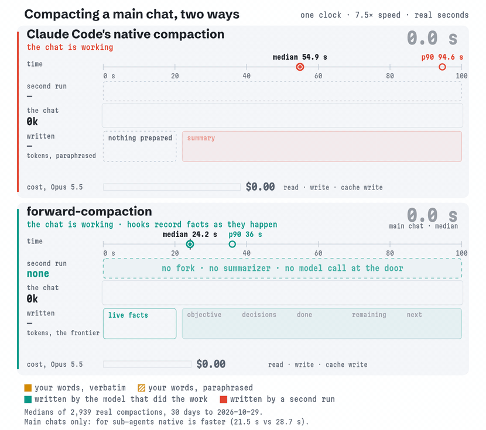
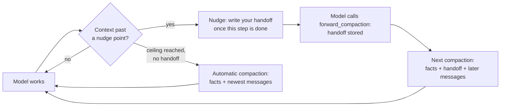

<div align="center">

# forward-compaction

**Claude Code compaction without the wait. The model writes its own handoff while it still remembers everything, so your exact words carry through.**

[](https://docs.claude.com/en/docs/claude-code/plugins)
[](./CHANGELOG.md)
[](./LICENSE)
[](#development)
[](https://github.com/rezzminator/professor)

</div>

<p align="center">
  <picture>
    <source media="(prefers-color-scheme: dark)" srcset="docs/assets/compaction-dark.gif">
    
  </picture>
</p>

<p align="center"><sub>Main chats, medians of 2,939 real compactions over 30 days to 2026-10-29; the clocks run 7.5× faster than real seconds. For sub-agents native is faster (21.5 s vs 28.7 s).</sub></p>

## Why

When a Claude Code chat fills its context, Claude Code compacts it. The chat stops, a second request re-reads the whole conversation and writes a summary, and the chat carries on from that summary. This has two costs:

- **You wait.** A main chat waits 55 seconds at the median and 95 at the 90th percentile, every time it compacts.
- **Your words become a paraphrase.** Your instructions, a sub-agent's brief, and what is done and what comes next are all retold by a request that never did the work.

forward-compaction turns this around. As the context grows, the model is told how full it is. At a clean point between steps it calls one tool and writes its own handoff: the goal, your rulings, what is done, what is left, and the next action. At the next compaction the plugin swaps the old conversation for that handoff in under a tenth of a second, and no summarizer runs.

## What you get

- **Faster main-chat compactions.** The median is 24.2 s instead of 54.9 s: the time the model spends writing its handoff, plus 0.085 s to install it.
- **Less context left behind.** About 8k tokens remain instead of 18.6k, so every later request carries less.
- **Your words, verbatim.** Your ten newest messages, every answer you gave to the model's questions, and the standing orders it recorded from you ("never push without asking") come through word for word.
- **Work in flight survives.** The messages after the handoff call stay exactly as they were. The skills in use, the files touched, the shell commands run and the task list come along too.
- **Every sub-agent too.** Each sub-agent compacts the same way and keeps its own brief.
- **A safety net.** A chat that never writes a handoff is compacted automatically at a ceiling, keeping your messages and its newest work.
- **A way back.** `look_back` searches the chat's own transcript from before the compaction for an exact detail the handoff left out.

## Benchmark

Measured on 2,939 real compactions in one heavy user's Claude Code transcripts over 30 days (2026-09-29 → 2026-10-29): 1,357 by Claude Code's native summarizer and 804 by forward-compaction, in main chats and sub-agents. Every figure comes from the compaction's own boundary record (duration, tokens before and after) or the handoff call's API usage, except where marked as estimated.

| Median (p90) | Native compaction | forward-compaction |
| --- | --- | --- |
| Main chat: time to compact | 54.9 s (94.6 s) | **24.2 s** (36.0 s), then a 0.085 s install |
| Sub-agent: time to compact | **21.5 s** (59.9 s) | 28.7 s (43.8 s), then a 0.12 s install |
| Main chat: context left after | 18.6k tokens (32.8k) | **8.0k tokens** (17.5k) |
| Sub-agent: context left after | 12.1k tokens (18.3k) | **8.8k tokens** (13.1k) |
| Text written per compaction | ~3.0k tokens of summary (estimated from its length) | 3.2k tokens of handoff (4.5k) in a main chat, 3.7k (6.1k) in a sub-agent |
| Cost of one main-chat compaction, Opus 5.5 | $0.25 | **$0.16** (−36%) |

Cost is one read of the context being compacted ($0.20/M cached), the text written ($20/M output) and the cache write of what is left after ($8/M, 1-hour cache), at the medians above. The native summarizer re-reads a larger context (214k vs 167k, because forward-compaction compacts at the model's own milestone) and leaves more than twice as much behind, which every later request then carries.

## Install

You need Claude Code with function hooks, an early-access feature. The plugin is tested on Claude Code 2.1.309.

**1. Turn on function hooks and lower the compaction window**, in the shell that starts Claude Code:

```sh
export CLAUDE_CODE_ENABLE_FUNCTION_HOOKS=1
export CLAUDE_CODE_AUTO_COMPACT_WINDOW=100000
```

Or, in the `env` block of `~/.claude/settings.json`:

```json
{
  "env": {
    "CLAUDE_CODE_ENABLE_FUNCTION_HOOKS": "1",
    "CLAUDE_CODE_AUTO_COMPACT_WINDOW": "100000"
  }
}
```

**2. Add the Professor marketplace and install the plugin:**

```sh
claude plugin marketplace add rezzminator/professor
claude plugin install forward-compaction@professor
```

Inside a chat, the same two steps are `/plugin marketplace add rezzminator/professor` and `/plugin install forward-compaction@professor`.

**3. Start a new Claude Code session**, so the variables and the plugin are both loaded.

To update later:

```sh
claude plugin marketplace update professor
claude plugin update forward-compaction@professor
```

**Why the lower window?** A plugin can hold back a compaction Claude Code asks for, but it cannot make Claude Code ask sooner. At `100000` Claude Code asks from about 63k tokens, so a sub-agent's handoff installs soon after it is written; the main chat's installs at the end of its turn either way. The plugin holds every ask until a handoff is ready or the ceiling is reached, so the lower window never compacts you early.

Coming from this repository's earlier plugin? The [CHANGELOG](./CHANGELOG.md) entry for 1.0.0, "Migrating from 0.8.0", maps every old setting.

## How it works



1. **Nudge.** After a tool result, once the context passes 15% of the main chat's window (40% for a sub-agent), the model reads one line saying how full it is and asking it to write its handoff once its current step is done. Another line follows every 5% (10% for a sub-agent).
2. **Handoff.** The model calls `forward_compaction`. The plugin stores the handoff and changes nothing yet; a later call replaces it.
3. **Install.** The main chat's handoff installs at the end of its turn, and a sub-agent's at Claude Code's next compaction ask. Everything before the call is replaced by the facts the plugin recorded and the handoff, and the messages after the call are kept, as many as fit.
4. **Ceiling.** A chat that reaches 60% of its window with no handoff (80% for a sub-agent) is compacted automatically, keeping the recorded facts, its newest messages and a note that no handoff was written.

### What the model wakes up with

After a compaction the model's context holds, oldest first:

1. **The facts the plugin recorded as they happened:** your standing orders; anything that arrived after the handoff call; the plan file when in plan mode; your ten newest messages and every answer you gave (or the sub-agent's brief); the skills in use; the agents and background shells; the shell commands it ran; the files it touched; the task list; and any files the handoff asked to carry.
2. **The handoff, word for word**, with an instruction to continue from its next action.
3. **The messages after the call, word for word**, as many as fit. Any dropped are named as not carried.

Every figure, limit and edge case is in the [behaviour reference](./docs/spec.md).

## The tools

### `forward_compaction`

The model writes its handoff with one call, one argument per section:

```text
forward_compaction({
  "objective": "…", "decisions": "…", "done": "…", "remaining": "…", "next": "…",
  "load_files": [{ "path": "/abs/plan.md", "why": "the plan I am executing" }]
})
```

| Argument | Required | What goes in it |
| --- | --- | --- |
| `objective` | yes | What the work is for and what done means. |
| `decisions` | yes | Every ruling you gave on how something gets done, in your words. |
| `done` | yes | The finished pieces, each with how it was verified. |
| `remaining` | yes | Every step left, in order. |
| `next` | yes | The first concrete action after the compaction. |
| `blocked`, `findings` | no | What waits on whom; the model's own notes, errors and commands it will need again. |
| `standing_orders` | no | Your orders that bind the rest of the work, in your exact words. The plugin keeps them across compactions until you lift them. |
| `lifted` | no | Orders you have lifted, with the words you lifted them with. |
| `load_files` | no | Files to read back in after the compaction, up to 250 lines each. |
| `drop_skills` | no | Skills no longer needed, dropped once two handoffs in a row name them. |

The call is never refused. The reply says when the handoff will install and names anything it left out. A handoff missing a required section is stored but does not install until a complete one replaces it.

### `look_back`

Searches the chat's own transcript from before its latest compaction for an exact detail: an error message, a value, something you said. It takes words to search for, or an entry number to read one entry whole.

## Configuration

### Options

Every option is an environment variable, set in the shell that starts Claude Code or in the `env` block of `settings.json`. The plugin has no `/config` screen. An unset or blank variable uses the default, and a bad value is named on screen and the default applies.

A **size** is a token count (`100000`), a number with a k or m suffix (`100k`, `0.6m`), or a percentage of the max context (`60%`). A **max context** is a token count, never a percentage. A **flag** is `1`, `0`, `true` or `false`. A **model list** is comma-separated parts of model ids, matched in any case; set to empty, it ignores no model.

| Variable | Type | Default | Meaning |
| --- | --- | --- | --- |
| `FORWARD_COMPACTION_MAIN_MAX_CONTEXT` | max context | `window` | The main chat's max context, which its sizes are a percentage of: by default the window Claude Code reports, read again after `/model`. |
| `FORWARD_COMPACTION_MAIN_CEILING` | size | `60%` | With no handoff stored, the main chat's context at which it is compacted automatically (1M window → 600k). |
| `FORWARD_COMPACTION_MAIN_NUDGE_START` | size | `15%` | The main chat's context at which it is first told its size and asked to write a handoff. |
| `FORWARD_COMPACTION_MAIN_NUDGE_EVERY` | size | `5%` | How much the main chat's context grows between nudges. |
| `FORWARD_COMPACTION_SUBAGENT_MAX_CONTEXT` | max context | `model` | Every sub-agent's max context when set; unset, each sub-agent's own: 1M for a model id carrying `[1m]`, 200k for any other ([Max contexts](./docs/spec.md#max-contexts)). |
| `FORWARD_COMPACTION_SUBAGENT_CEILING` | size | `80%` | With no handoff stored, a sub-agent's context at which it is compacted automatically (160k on 200k). |
| `FORWARD_COMPACTION_SUBAGENT_NUDGE_START` | size | `40%` | A sub-agent's first nudge (80k on 200k), above the 55-60k a sub-agent starts at after a compaction, so a handoff never loops. |
| `FORWARD_COMPACTION_SUBAGENT_NUDGE_EVERY` | size | `10%` | How much a sub-agent's context grows between nudges (20k on 200k). |
| `FORWARD_COMPACTION_CEILING_NATIVE` | flag | `0` | `1`: at the ceiling with no handoff, Claude Code's own summary runs instead of the automatic compaction. |
| `FORWARD_COMPACTION_IGNORE_MODELS` | model list | `haiku` | Models that get no nudge and are compacted automatically at their ceiling; a handoff they write still installs ([Ignored models](./docs/spec.md#ignored-models)). |
| `FORWARD_COMPACTION_KEEP_SKILLS` | name list | `none` | Skills and commands never dropped after a compaction, comma-separated; a skill file's `forward-compaction-keep: true` frontmatter does the same. |
| `FORWARD_COMPACTION_DEBUG` | flag | `1` | `0`: no `debug.jsonl`, the row the plugin writes at every step. |

An example `settings.json`:

```json
{
  "env": {
    "CLAUDE_CODE_ENABLE_FUNCTION_HOOKS": "1",
    "CLAUDE_CODE_AUTO_COMPACT_WINDOW": "100000",
    "FORWARD_COMPACTION_MAIN_CEILING": "60%",
    "FORWARD_COMPACTION_IGNORE_MODELS": "haiku"
  }
}
```

### Logs

The plugin writes its logs to `~/.local/state/forward-compaction/logs/`, or to `$PLUGIN_LOG_DIR/forward-compaction/` when `PLUGIN_LOG_DIR` is set:

- `decisions/{session}.jsonl`: every handoff stored, nudge sent and compaction decided, one file per session.
- `errors.jsonl`, `warnings.jsonl`, `info.jsonl`, and `debug.jsonl` while `FORWARD_COMPACTION_DEBUG` is on.
- `issues.md`: notes a model appends when the plugin gave it trouble.

Only errors reach the screen. Logs never hold handoff or transcript text, and the log files rotate on their own; [State on disk](./docs/spec.md#state-on-disk) has the sizes and retention.

## Limits

- **Sub-agents are slower to compact.** Writing a handoff takes a sub-agent 28.7 s at the median, against 21.5 s for Claude Code's summary. The gain there is what the handoff keeps, not speed.
- **Your own `/compact` runs Claude Code's summary.** A stored handoff is dropped, and the screen says so.
- **Handoffs live in memory.** Quitting before a handoff installs loses it, though its text stays in the transcript, where `look_back` finds it.
- **Function hooks are early access** and may change between Claude Code releases.

## FAQ

<details>
<summary><b>What if the model never writes a handoff?</b></summary>

It is reminded at each nudge point. At its ceiling (60% of the main chat's window, 160k for a sub-agent, by default) the plugin compacts it automatically: the recorded facts and its newest messages, with a note that no handoff was written. Set `FORWARD_COMPACTION_CEILING_NATIVE=1` to let Claude Code's own summary run there instead.
</details>

<details>
<summary><b>Does a sub-agent with a <code>tools:</code> allowlist get the tool?</b></summary>

The plugin cannot see a sub-agent's tool list, so it nudges it anyway, and the nudge tells it to carry on if the tool is not in its list. Such a sub-agent is compacted automatically at its ceiling, keeping its brief, its skills and its newest messages.
</details>

<details>
<summary><b>Why not use the <code>PreCompact</code> hook?</b></summary>

The classic `PreCompact` hook fires for a sub-agent's compaction without the agent's id, so it cannot tell which chat is compacting ([#91910](https://github.com/anthropics/claude-code/issues/91910)). Function hooks carry `agentId` on `session.compact`, which is what this plugin decides on.
</details>

<details>
<summary><b>Does a handoff survive a restart or <code>claude --resume</code>?</b></summary>

No. Stored handoffs and recorded facts live in the plugin's memory: the main chat installs its handoff at the same turn's end, and a sub-agent's ends with its process. The handoff text stays in the transcript as the tool call's input, where `look_back` finds it. After a resume the facts message says when recording started.
</details>

<details>
<summary><b>Could compaction be started from a plugin instead?</b></summary>

Not yet for sub-agents: a plugin can only answer Claude Code's compaction ask, which is why the install step lowers the window. Letting a plugin start one directly is requested upstream in [anthropics/claude-code#91870](https://github.com/anthropics/claude-code/issues/91870#issuecomment-5848066352).
</details>

## Development

```sh
npm install
npm test              # unit, adapter, replay and layout tests
npm run typecheck
npm run validate:plugin
npm run replay:record # records a live replay fixture (a paid Claude Code session)
```

The [behaviour reference](./docs/spec.md) is the plugin's full specification. Pull requests go to `develop`; `main` holds only releases, and `make release-check` runs the release checks locally.

## Built with Professor

forward-compaction is built and maintained with [Professor](https://github.com/rezzminator/professor), a discipline layer for Claude Code, Codex and OpenCode that runs long orchestrations of sub-agents. Keeping their work intact across compactions is why this plugin exists.

## License

MIT

<sub>Keywords: Claude Code compaction · model-written handoff · forward compaction · sub-agent compaction · self-compaction · context window management · CLAUDE_CODE_AUTO_COMPACT_WINDOW · Claude Code plugin · function hooks · Claude Mods · multi-agent orchestration</sub>
