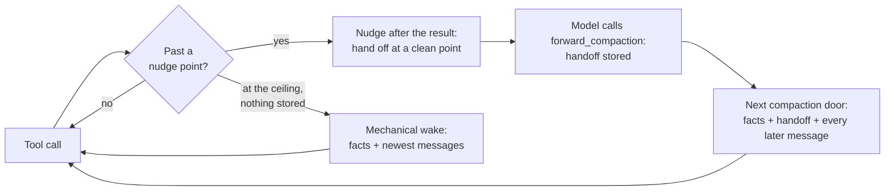

<div align="center">

# forward-compaction

**Compaction for Claude Code where the model writes its own handoff: the main chat and every sub-agent hand off through one tool, and everything after the call stays verbatim.**

[](https://docs.claude.com/en/docs/claude-code/plugins)
[](./CHANGELOG.md)
[](./LICENSE)
[](#development)
[](https://github.com/rezzminator/professor)

</div>

```text
forward_compaction({
  "handoff": "## Objective\n…\n## Done\n…\n## Remaining\n…\n## Next\n…",
  "load_files": [{ "path": "/abs/plan.md", "why": "the plan I am executing" }]
})
```

<sup>One call, one markdown argument. At Claude Code's next compaction the plugin replaces everything before the call with recorded facts plus this handoff, and keeps every message after it word for word.</sup>

---

Claude Code compacts by asking a summarizer to paraphrase the whole
conversation. The paraphrase loses what matters most to the party being
compacted: the person's exact words, a sub-agent's brief, the skills in
force, and the frontier — what is done, what is left, what comes next.

**forward-compaction** lets the model write that frontier itself, while it
still holds the context, and builds the rest from facts the plugin recorded
as they happened.

- ✍️ **The model writes the frontier.** `forward_compaction` takes one
  markdown handoff with `## Objective`, `## Done`, `## Remaining` and
  `## Next`. It is stored, never summarized, and installed verbatim.
- 🧾 **Facts are recorded, never reconstructed.** The person's messages (main
  chat) or the brief (sub-agent), messages from the coordinator, the skills
  loaded, the agents and the background shells come from typed hook events as
  they happened. Nothing is grepped out of a transcript or re-read from disk.
- ⏩ **Everything after the call is kept.** The model need not stop after it
  hands off: every message from the call on stays in the new context as it
  was, so no work done after the handoff is lost.
- 👥 **Every party.** The main chat and every sub-agent use the same tool;
  each has its own stored handoff, nudges and readings.
- 🛟 **A ceiling as the safety net.** A party that never hands off is
  compacted mechanically at its ceiling: the same recorded facts and its
  newest messages, kept verbatim.
- 📜 **Every decision logged** to a JSONL file per session.

## 📊 Benchmark

No benchmark of forward-compaction has been measured yet. The figures the
earlier plugin of this repository published measured a different mechanism
(a summarizer run at a milestone) and are not claimed for this one.

## 🚀 Quick start

```sh
# 1. Turn on function hooks, and let Claude Code ask to compact from about 63k
export CLAUDE_CODE_ENABLE_FUNCTION_HOOKS=1
export CLAUDE_CODE_AUTO_COMPACT_WINDOW=100000

# 2. Install
claude plugin marketplace add https://github.com/rezzminator/sub-agent-compact.git
claude plugin install forward-compaction@forward-compaction
```

Both variables also work in the `env` block of `settings.json`. With the
defaults every party is nudged to hand off from 50k tokens, again every 10k,
and compacted mechanically at 60% of its model's window if it never does.

> **Early access.** This plugin is built on Claude Code's function hooks,
> an early-access surface that may change between releases. It is tested on
> Claude Code 2.1.309.

Moving from the earlier plugin of this repository? The
[CHANGELOG](./CHANGELOG.md) entry for 1.0.0-dev.1 maps every old setting.

## 🧠 How it works



1. **Nudges.** After a tool result, once a party's context passes
   `FORWARD_COMPACTION_NUDGE_START`, the model reads one line asking it to
   hand off at its next milestone, at a clean point and never mid-edit. One
   more follows every `FORWARD_COMPACTION_NUDGE_EVERY`. While Claude Code has
   not yet asked to compact the party the line says "at your next
   milestone"; once it has asked, or the reading is past Claude Code's ask
   point, it says "now".
2. **Handing off.** The model calls `forward_compaction` (the model sees
   `mcp__forward-compaction__forward_compaction`). The plugin checks the
   headings and files and stores the handoff in memory for that party, or
   refuses the call and stores nothing, naming what to fix. A later call
   replaces the stored one.
3. **Installing.** The stored handoff installs at the next door Claude Code
   opens: for the main chat at the end of the turn (the plugin asks Claude
   Code to compact) or at an automatic ask if one comes first; for a
   sub-agent at Claude Code's next automatic ask. No summarizer request runs.
4. **The ceiling.** An automatic ask with nothing stored is held, and the
   nudge turns to "now". Once the party reaches its ceiling with still
   nothing stored, or Claude Code asks again with no response in between
   (its "prompt is too long" recovery), the plugin installs a mechanical wake.

### The tool

`forward_compaction({handoff, load_files})`, with its schema in the prompt's
tool list (not deferred), so a nudged model needs no ToolSearch.

- `handoff` (required): markdown, at most 20,000 characters, with the
  level-2 headings `## Objective`, `## Done`, `## Remaining` and `## Next`,
  each once and each followed by at least one line. `## Blocked` and
  `## Findings` are optional; any other heading and any text are kept
  verbatim. Nothing is ever trimmed.
- `load_files` (optional): at most 8 `{path, lines?, why}` entries, each an
  absolute path to a regular file of at most 1,048,576 bytes, `why` 1–200
  characters, `lines` a range like `10-40` or `1-60,160-185`. Each file is
  read when the handoff installs and carried whole; one too big for the room
  left is named as not carried, never cut.

The result is a receipt saying when the handoff installs — for the main chat
at the end of this turn, for a sub-agent at Claude Code's next ask (with
where that ask comes and where the sub-agent is now) — and, when it replaced
one, at what size the earlier one was stored. A refusal starts
`forward_compaction refused, nothing stored:` and names the field to fix:
an unknown field, a missing, repeated or empty heading, a handoff over the
cap, a bad `load_files` entry, or a file that is absent, not a regular file,
too large or could not be checked. A refusal is a tool answer, not an error,
so the model reads it and calls again.

### The wake

The installed context is, oldest first: one facts message, one handoff
message, then the messages after the call, returned as Claude Code holds
them.

The facts message holds, each section only when it has content:

- the brief (sub-agent), verbatim, or the person's messages (main chat),
  oldest first;
- messages from the coordinator (sub-agent) or notifications delivered
  (main chat);
- the results of the tool calls made in the same response as the handoff;
- the skills in force, as they were loaded. A skill Claude Code loaded
  without saying which party loaded it is named, not carried, in every
  party's wake, with the call that loads it again;
- the agents, listed at install (at most 50 rows);
- the background shells and crons, from the newest Stop event, with its age.
  The list is session-wide, not per agent; before any Stop event it says the
  running shells are unknown;
- the files the handoff asked to carry, and the ones not carried with why.

Its size is held to a budget of half Claude Code's ask point (31,500 tokens
at `CLAUDE_CODE_AUTO_COMPACT_WINDOW=100000`), estimated at 3.5 characters per
token. Each section has a share — brief or person's messages 25%,
coordinator messages or notifications 5%, sibling results 10%, skills 25%,
files 15% and 40,000 characters per file — and is carried whole or named as
not carried, never cut; the person's messages and skills are carried newest
first while they fit. The room left goes to the messages after the call: the
oldest are dropped whole until the rest fits, and the handoff message says
how many were dropped.

The handoff message carries the handoff verbatim, tells the model it is its
frontier and to continue from `## Next`, and says how many later messages
follow. A mechanical wake replaces it with a message saying no frontier was
written, how many of the newest messages were kept and how many are gone,
and to re-establish the objective from the person's messages or the brief.

Each install prints one line, such as
`main handoff landed — 96k → 22k tokens; frontier 4,812 characters, 5 facts, 12 messages kept verbatim.`
or `Explore 3f2a9c had no handoff at 120k (ceiling 120k) — mechanical wake installed, 120k → 30k.`

### What else happens at a compaction

- A person's `/compact` runs Claude Code's own summary untouched; a stored
  handoff is dropped, and the screen says so.
- A message the person sends after the call does not cancel a stored handoff:
  it is among the messages kept after the call.
- A stored handoff whose call is no longer in the party's transcript
  (something else compacted it) is dropped and said on screen; the ask is
  then judged as if nothing were stored.
- An engine loop that is not one of the session's sub-agents (a fork Claude
  Code runs itself) is left to Claude Code.
- A `precompute` ask is skipped: it is never used.
- An error inside the compaction hook never reaches Claude Code: the plugin
  installs a mechanical wake instead, built without any read, and if that
  fails too, Claude Code's own summary runs. Either way the error is on the
  screen.
- When the main chat's turn-end install is skipped or rejected, the handoff
  stays stored for the next turn end or ask, and a skip is said on screen.
- A party's context that falls to half or less with no compaction this
  plugin handled (another plugin or Claude Code compacted it) is said on
  screen.

### Look back

`look_back` (`mcp__forward-compaction__look_back`) searches only the caller's
own transcript before its latest compaction, for an exact detail the wake no
longer holds. Supply `query` (case-insensitive words; double quotes keep a
phrase whole) or `entry: N` to fetch one entry whole. Results rank by how
many terms an entry holds, then newest first. Every call is logged as a
compaction miss, and the person is told what was looked up.

## ⚙️ Configuration

### Options

Every option is an environment variable, set in the shell that starts Claude
Code or in the `env` block of `settings.json`. The plugin declares no
`userConfig` and has no `/config` screen; an options object handed to it is
named in one warning and not applied. An unset, empty or blank variable is
absent and the default applies; a bad value is named by its variable on the
screen and in the log, and the default applies.

A **size** is a token count (`100000`), a number with a k/m suffix
(`100k`, `0.6m`), or a percentage of the party's model window above 0 and at
most 100 (`60%`). A **flag** is `1`, `0`, `true` or `false` in any case.

| Variable | Type | Default | Meaning |
| --- | --- | --- | --- |
| `FORWARD_COMPACTION_CEILING` | size | `60%` | With no handoff stored, the context at which the plugin installs a mechanical wake. A percentage is of the party's model window (200k model → 120k, 1M model → 600k), not held to `CLAUDE_CODE_AUTO_COMPACT_WINDOW`; set an absolute size such as `100000` to hold every party there. |
| `FORWARD_COMPACTION_CEILING_NATIVE` | flag | `0` | `1`: at the ceiling with no handoff, Claude Code's own summary runs instead of the mechanical wake. |
| `FORWARD_COMPACTION_NUDGE_START` | size | `50k` | The context at which the model is first asked to hand off. |
| `FORWARD_COMPACTION_NUDGE_EVERY` | size | `10k` | How much the context grows between nudges. |
| `FORWARD_COMPACTION_LOG_FILE` | path | `~/.local/state/forward-compaction/logs/decisions/.jsonl` | Where decision rows go; each session writes `{session}.jsonl` beside it. With `PLUGIN_LOG_DIR` set the default is `$PLUGIN_LOG_DIR/forward-compaction/decisions/.jsonl`. A relative path is refused and the default applies. |

A nudge start at or past the ceiling in the same unit is kept and named once:
no nudge goes out before the ceiling. A ceiling below Claude Code's ask point
is named once at start: a party with no handoff is then compacted
mechanically at its first ask.

```json
{
  "env": {
    "CLAUDE_CODE_ENABLE_FUNCTION_HOOKS": "1",
    "CLAUDE_CODE_AUTO_COMPACT_WINDOW": "100000",
    "FORWARD_COMPACTION_CEILING": "60%",
    "FORWARD_COMPACTION_NUDGE_START": "40k"
  }
}
```

The plugin also reads, and does not own, `CLAUDE_CODE_AUTO_COMPACT_WINDOW`,
`PLUGIN_LOG_DIR`, `HOME` and `CLAUDE_CONFIG_DIR` (for `look_back`).

### The window rule

A plugin can hold a compaction back, but it can't make Claude Code ask
sooner. Claude Code asks to compact a party about 37k below the window it
compacts against — the party's model window, or
`CLAUDE_CODE_AUTO_COMPACT_WINDOW` when that is smaller — so about 63k with
`100000`. A sub-agent's handoff installs only at such an ask, so **set
`CLAUDE_CODE_AUTO_COMPACT_WINDOW=100000`**: when it is unset or above
100000 the plugin says so once at start. Past that point Claude Code asks
before every request, so the nudges go on until the ceiling. The main chat
does not wait for an ask: its handoff installs at the end of its turn.

Letting a plugin start a compaction for any sub-agent from code would remove
this rule. It is requested upstream in
[anthropics/claude-code#91870](https://github.com/anthropics/claude-code/issues/91870#issuecomment-5848066352).

### Model windows

Percentages are of each model's own window. The main chat's comes from
Claude Code, read at session start and again when its model changes (`/model`); 200k when it cannot be read. A sub-agent's comes from its model
id: Haiku 4.5 and older 200k; Haiku 5 and later, Sonnet 5 and any `[1m]`
model 1M; a model that is not Claude (a GPT model behind a gateway) Claude
Code's 200k default; any other Claude model the main chat's window.

### State on disk

| Path | What | Retention |
| --- | --- | --- |
| `~/.local/state/forward-compaction/logs/decisions/{session}.jsonl` (`$PLUGIN_LOG_DIR/forward-compaction/decisions/` when set) | decision rows: every handoff stored or refused, every nudge, every compaction decision | a file over 8 MiB moves to `.1`; other sessions' files older than 14 days, then all but the newest 200, are deleted |
| `~/.local/state/forward-compaction/logs/{errors,warnings,info}.jsonl` (`$PLUGIN_LOG_DIR/forward-compaction/` when set) | the plugin's errors, warnings and info | a level file over 20 MiB moves to `.1` |
| anything else | none: the recorded facts and the stored handoffs live in memory only | — |

Errors always reach the screen and the log. Warnings and info stay in the
logs while a log works, and reach the screen when no log is available or
logging fails. Rows never hold handoff or transcript bodies.

## ❓ FAQ

<details>
<summary><b>How is this different from Claude Code's own compaction?</b></summary>

Claude Code asks a summarizer to rewrite the whole conversation. Here the
model writes the frontier itself through `forward_compaction`, the plugin
supplies the facts it recorded, and every message after the call stays
verbatim. No summarizer request runs.
</details>

<details>
<summary><b>What if the model never calls the tool?</b></summary>

It is nudged from 50k, again every 10k. At its ceiling (60% of its model's
window by default) the plugin installs a mechanical wake: the recorded facts
and the newest messages that fit, with a line telling the model no frontier
was written. Set `FORWARD_COMPACTION_CEILING_NATIVE=1` to let Claude Code's
own summary run there instead.
</details>

<details>
<summary><b>Does a sub-agent with a <code>tools:</code> allowlist get the tool?</b></summary>

A sub-agent's tool list is not visible to the plugin, so it is nudged anyway;
the nudge tells it to carry on if the tool is not in its list. Such a
sub-agent is compacted mechanically at its ceiling, keeping its brief, its
skills and its newest messages.
</details>

<details>
<summary><b>Why doesn't the PreCompact hook work for this?</b></summary>

The classic `PreCompact` hook fires for a sub-agent's compaction without the
agent's id, so it can't tell which party is compacting
([#91910](https://github.com/anthropics/claude-code/issues/91910)). Function
hooks carry `agentId` on `session.compact`, which is what this plugin
decides on.
</details>

<details>
<summary><b>Does a handoff survive a restart or <code>claude --resume</code>?</b></summary>

No. Stored handoffs and recorded facts live in the plugin's memory: the main
chat installs at the same turn's end, and a sub-agent ends with its process.
The handoff text stays in the transcript as the tool call's input, where
`look_back` finds it. After a resume the facts message says when recording
started.
</details>

## 🛠️ Development

```sh
npm install
npm test              # unit, adapter, replay and layout tests
npm run typecheck
npm run validate:plugin
npm run replay:record # records a live replay fixture (a paid Claude Code session)
```

The live replay fixture exercises every replay invariant but two, which the replay test names: I2, a precompute ask (Claude Code 2.1.309 sent none; `tests/decide.test.ts` covers C2), and I11, tail handles shared by two chained installs (a chained handoff's call comes after everything the install before it kept, so the two tails share no message).

Work lands on `develop`; `main` holds only releases. Merging the `develop → main` pull request is the release: [`release.yml`](./.github/workflows/release.yml) tags the merge commit `forward-compaction--vX.Y.Z` and publishes its notes from [CHANGELOG.md](./CHANGELOG.md). `make release-check` runs that pull request's checks locally first. Pull requests go to `develop`.

`plugins/forward-compaction/hooks/forward-compaction.ts` is a thin adapter over `plugins/forward-compaction/src/`:

| Module | Role |
| --- | --- |
| `options.ts` | Sizes, flags and the `FORWARD_COMPACTION_*` variables, resolved with their defaults |
| `window.ts` | Model windows, Claude Code's ask point and the ceiling |
| `ledger.ts` | The facts recorded from typed hook events, per party |
| `handoff.ts` | The tool's description and schema, its validation and refusals, and the receipt |
| `wake.ts` | The split at the call, the budget, the facts and handoff messages, the tail that fits, the screen lines |
| `decide.ts` | The decision for one compaction ask, and the token estimate |
| `nudge.ts` | Nudge levels and text |
| `parties.ts` | Per-party state: readings, the stored handoff, nudges sent |
| `unseen.ts` | A context fall no compaction of this plugin explains |
| `look-back.ts` | The `look_back` tool |
| `log.ts` | The decision log and the level logs |
| `bounded.ts` | Bounds a promise with a timer passed in: tool registration holds a turn at most 5s |
| `register.ts` | Which tools still need a registration try, up to three each |

## 🎓 Built with Professor

forward-compaction is built and maintained with [Professor](https://github.com/rezzminator/professor), a fleet controller and discipline layer for Claude Code, Codex and OpenCode: chats that message each other, agents held to the project's rules, and gated releases. Professor runs long orchestrations of sub-agents, and keeping their work intact across compactions is why this plugin exists.

## License

MIT

<sub>Keywords: Claude Code compaction · model-written handoff · forward compaction · sub-agent compaction · self-compaction · context window management · CLAUDE_CODE_AUTO_COMPACT_WINDOW · Claude Code plugin · function hooks · Claude Mods · multi-agent orchestration</sub>
