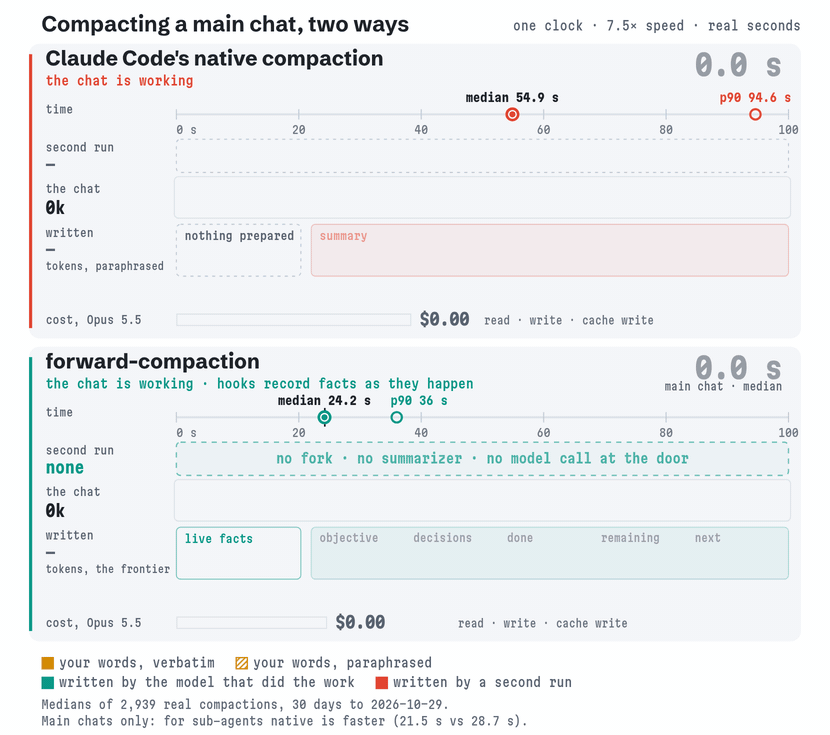

# Field medians: 2,939 real compactions

  <picture>
    <source media="(prefers-color-scheme: dark)" srcset="assets/compaction-dark.gif">
    
  </picture>

Main chats, medians of 2,939 real compactions over 30 days to 2026-10-29; the clocks run 7.5× faster than real seconds.

Measured on 2,939 real compactions in one heavy user's Claude Code transcripts over 30 days (2026-09-29 → 2026-10-29): 1,357 by Claude Code's native summarizer and 804 by forward-compaction, in main chats and sub-agents. Every figure comes from the compaction's own boundary record (duration, tokens before and after) or the handoff call's API usage, except where marked as estimated.

| Median (p90) | Native compaction | forward-compaction |
| --- | --- | --- |
| Main chat: time to compact | 54.9 s (94.6 s) | **24.2 s** (36.0 s), then a 0.085 s install |
| Sub-agent: time to compact | **21.5 s** (59.9 s) | 28.7 s (43.8 s), then a 0.12 s install |
| Main chat: context left after | 18.6k tokens (32.8k) | **8.0k tokens** (17.5k) |
| Sub-agent: context left after | 12.1k tokens (18.3k) | **8.8k tokens** (13.1k) |
| Text written per compaction | ~3.0k tokens of summary (estimated from its length) | 3.2k tokens of handoff (4.5k) in a main chat, 3.7k (6.1k) in a sub-agent |
| Cost of one main-chat compaction, Opus 5.5 | $0.25 | **$0.16** (−36%) |

Cost is one read of the context being compacted ($0.20/M cached), the text written ($20/M output) and the cache write of what is left after ($8/M, 1-hour cache), at the medians above. The native summarizer re-reads a larger context (214k vs 167k, because forward-compaction compacts at the model's own milestone) and leaves more than twice as much behind, which every later request then carries.
