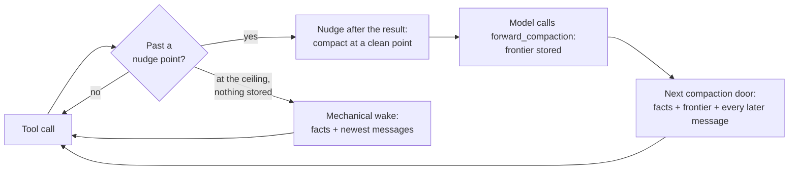

# forward-compaction — behaviour reference

This is the full behaviour of the plugin: every rule, limit and edge case the code holds. Start with the [README](../README.md) to install it and pick your settings; option defaults live only in the README's [Options](../README.md#options) table.

## What a compaction keeps

- ✍️ **The model writes the frontier.** `forward_compaction` takes one
  argument per section — `objective`, `decisions`, `done`, `remaining` and
  `next`, each MANDATORY — and assembles them into one markdown frontier. It
  is stored, never summarized, and installed verbatim; one missing a
  MANDATORY section is stored but never installed.
- 🧾 **Facts are recorded, never reconstructed.** The person's messages (main
  chat) or the brief (sub-agent), the messages delivered to it, the skills
  loaded, the agents and the background shells come from typed hook events as
  they happened. Nothing is grepped out of a transcript or re-read from disk.
  Each party's newest prompts (the person's ten newest typed messages and every
  answer they gave to an AskUserQuestion, or a sub-agent's brief and the ten
  newest delivered to it) and the skills it loaded
  (the latest text of each), and the standing orders of its last stored
  frontier, are also held in Claude Code's session state, so a
  plugin reload (`/reload-plugins`) does not lose them. The files touched and the task list come from each finished tool call.
- ⏩ **The messages after the call are kept.** The model need not stop after it
  compacts: the newest messages from the call on stay in the new context as
  they were, as many as fit, and any left out are named as not carried. Anything delivered between
  the call and the install that those messages lack (a notification of an
  agent or command finishing, the person's message, a coordinator's message)
  is carried in the wake under its own heading, as the model has not read it.
- 👥 **Every party.** The main chat and every sub-agent use the same tool;
  each has its own stored frontier, nudges, readings and ceiling. A model on
  the ignore list (Haiku by default) takes no frontier and is held to its
  ceiling, then compacted mechanically ([Ignored models](#ignored-models)).
- 🛟 **A ceiling as the safety net.** A party that never compacts is
  compacted mechanically at its ceiling: the same recorded facts and its
  newest messages, kept verbatim.
- 📜 **Every decision logged** to a JSONL file per session, and every step
  to a debug log, with the numbers as Claude Code's API gave them.

## How it works

A party's context is its last measured reading: the input, cache-read,
cache-write and output tokens of its last completed request, as `turn.step`
reports them. The nudge, the ceiling and the mechanical decision use it, so a
nudge may come one step late. No number is ever estimated from characters: a
party with no reading at all, none yet or none since an install, gets no nudge
and no ceiling, and an automatic ask from it with nothing stored is held as
`no-reading` until its next reading decides.

1. **Nudges.** After a tool result, once a party's context passes its nudge
   start (`FORWARD_COMPACTION_MAIN_NUDGE_START` or
   `FORWARD_COMPACTION_SUBAGENT_NUDGE_START`, a share of its max context), the
   model reads one line saying how large its context is, as tokens and as a
   share of its max context. One more follows every
   `FORWARD_COMPACTION_{MAIN|SUBAGENT}_NUDGE_EVERY`. The line asks it to call
   `forward_compaction` once its current step is done, never in the middle of
   one, and to skip it only when nothing is left but its final answer; it
   names the ceiling. A held
   compaction ask adds no nudge of its own. After an install, the first
   reading's level is absorbed silently (a sub-agent's floor of system
   prompt, tools and skills is already 55-60k), so the next nudge goes only
   when the context crosses the level above it and has grown by at least
   one `NUDGE_EVERY` past that first reading: a first reading just under a
   level brings no nudge a few thousand tokens later. A model on the ignore list
   gets no nudge.
   No call is ever refused or held back: a party that does not compact is
   compacted mechanically at its ceiling.
2. **Compacting.** The model calls `forward_compaction` (the model sees
   `mcp__forward-compaction__forward_compaction`). The plugin stores the frontier
   in memory for that party and never refuses the call: an argument it cannot
   use is left out or skipped, and the receipt names it. A later call
   replaces the stored one. A frontier missing a MANDATORY section is stored
   but never installs: every door treats it as nothing stored, until a later
   call with every MANDATORY section replaces it.
3. **Installing.** The stored frontier installs at the next door Claude Code
   opens: for the main chat at the end of the turn (the plugin asks Claude
   Code to compact) or at an automatic ask if one comes first; for a
   sub-agent at Claude Code's next automatic ask. No summarizer request runs.
4. **The ceiling.** An automatic ask with nothing stored is held. Once the
   party reaches its ceiling with still
   nothing stored, or Claude Code asks again with no response in between
   (its "prompt is too long" recovery), the plugin installs a mechanical wake.

### The tool

`forward_compaction({objective, decisions, done, remaining, next, blocked, findings, load_files, drop_skills, standing_orders, lifted})`,
with its schema in the prompt's tool list (not deferred), so a nudged model
needs no ToolSearch.

- `objective`, `decisions`, `done`, `remaining`, `next` (required, each
  description opening `MANDATORY:`): non-blank strings — what the work is for
  and what done means; every ruling the person gave on how something gets
  done, in the person's words, each with its undo when one exists, `none`
  when there are none; the finished pieces, each with how it was verified,
  every figure with the command that produced it; every step left, in order,
  `none` when nothing is left; the first concrete action after the wake.
  `decisions` holds how a thing gets done ("the result is `already_sent`, not
  `sent`"); a rule that binds the rest of the work goes in `standing_orders`.
- A frontier missing a required section (absent, not a string, or blank) is
  stored, never refused, but never installs: Claude Code's asks stay held as
  if nothing were stored (until the ceiling's mechanical wake), and the main
  chat's turn end does not install it. The decision log's `stored` row names
  the sections as `incomplete`. A later call with every required section
  replaces it and installs as usual.
- `blocked`, `findings` (optional): strings — what waits on whom; the party's
  own choices with why, errors verbatim, the commands and recipes the party
  will need again. Absent or blank, the section is left out.
- The plugin assembles the frontier as `## Objective`, `## Decisions`,
  `## Done`, `## Remaining`, `## Next`, then `## Blocked` and `## Findings` when given,
  each heading followed by its argument verbatim and a blank line between
  sections. The frontier has no length cap: it is stored and installed
  whole, never trimmed.
- `load_files` (optional): `{path, lines?, why}` entries, as many as the
  party needs, each an absolute path to a regular file, `why` 1–200
  characters, `lines` a range like `10-40` or `1-60,160-185`. Their size never
  refuses the frontier: it is always stored. Each file is read when the
  frontier installs and carries at most 250 lines: of its `lines` ranges when
  given, else from line 1. When lines are left past the 250th, the file's
  block ends with one line, `[N more lines not carried: Read {path} from line
  L]`, N the lines left in the ranges or the file and L the next one. There is
  no room for the files together. A file that is missing, or whose ranges
  hold no line, is named under `## Files not carried` with why.
- `drop_skills` (optional): at most 32 names of skills or commands the party
  loaded and no longer needs. A name is dropped only when two frontiers in a
  row name it: the second one's wake leaves it out, and so does every later
  wake until the party loads it again. A frontier that does not name it starts
  the count again. A skill or command whose file's frontmatter sets
  `forward-compaction-keep: true`, or that `FORWARD_COMPACTION_KEEP_SKILLS`
  names, is never dropped, whoever asks; the wake
  marks it `pinned: never dropped`. A pin exempts it from `drop_skills` only:
  it is cut and fitted to the skills' limits like any other. The receipt says, per name, whether it
  was dropped, waits for the next frontier, is pinned, or was never loaded.
- `standing_orders` (optional): the person's orders that bind the rest of the
  work (a prohibition, a limit, a rule), each `{order, at}`: `order` the
  person's words verbatim, `at` the ISO time of the message that gave it,
  optional: an order with no `at` or a malformed one is kept when a recorded
  message of the person's holds its words, and skipped otherwise. The
  model names them; the plugin never guesses one from the person's wording.
  When a recorded message of the person's holds the order's words, the plugin
  stamps `at` from the first such message, never the model's guess, a
  remembered order's included. Words match across spacing and letter case: a
  model that rejoins the person's lines or re-cases a word still quotes them.
  The plugin remembers the standing orders of each party's last stored
  frontier, across installs, the mechanical wake, the person's own `/compact`
  and a plugin reload. The party's next frontier carries each one again with the
  same `order` text, or lifts it; an order it leaves out is carried on by the
  plugin from that memory, and the receipt names it.
- `lifted` (optional): the orders the person has lifted, each `{order, by}`:
  `order` exactly the text the last frontier carried, `by` the person's words
  that lifted it, verbatim (spacing and letter case aside). A lift counts only when `by` is found in a message
  the plugin recorded for the party and sent after the order's `at`: the
  person's messages for the main chat, its brief or a message delivered to it
  for a sub-agent. Words said before the order was given lift nothing. Only a
  lift clears a remembered order; a lift whose words no such message holds
  leaves the order binding, and the receipt names it. A lift of a text that is
  no remembered order is ignored.

The result is a receipt saying when the frontier installs — for the main chat
at the end of this turn, for a sub-agent at Claude Code's next ask (with
where that ask comes) — and, when it replaced one, that it did. It prints no
context size: the plugin measures none for that moment. A call is always stored. When the plugin left
something out, skipped it or carried it on, the receipt ends with
`Stored with N changes:` and one line each: an unknown field, a section that is
missing, blank or not a string, a bad `drop_skills` name, a bad
`standing_orders` or `lifted` entry, a standing order the frontier left out
(carried on), a lift whose words no recorded message sent after the order holds
(the order still binding), a lift of no remembered order, a `load_files` entry
that is bad, absent, not a regular file or could not be checked,
a call with no `tool_use_id`, which the wake cannot place, and a field taken
back out of a section that holds its own closing tag then
`<parameter name="…">` (the model's call markup closed the section early; an
array field is read as JSON, and a field the call also sent keeps the sent
value). A frontier
missing a required section opens its receipt with `but a MANDATORY section is
missing, so it does not install`, names each missing section in that list,
and ends it with `This frontier will not install until you call
forward_compaction again with every MANDATORY section.`

Every answer ends with one line saying the
plugin is experimental and asking the model to append a short note of any
trouble to `issues.md` in the level-log directory (the reply itself when no
directory resolves).

### The wake

The installed context is, oldest first: one facts message, one frontier
message, then the messages after the call, returned as Claude Code holds
them. The frontier message carries the call's own receipt, since the install
replaces the message that held it, and, like a mechanical wake's message,
ends with the experimental line and where to note any trouble.

The facts message opens with the plugin version that built the wake
(`compacted by forward-compaction 2.2.3`), so a chat on an old build shows
it. It holds, each section only when it has content:

- the standing orders, first, under `## Standing orders — binding until the
  person lifts them`: each order the frontier carried with its time, carried
  whole, outside the budget; then each order lifted since the last install,
  once, with the person's lifting words, and never again. A mechanical wake
  carries the party's remembered orders the same way, and the frontier
  message and the mechanical wake's message both say to continue within
  them;
- what arrived after the frontier and the kept messages lack: every
  notification, message from the person or the coordinator, and message that
  resumed a sub-agent, verbatim, first;
- plan mode and the plan file, when the party's plan-mode attachments
  (Claude Code's `prompt.attachment` rows `plan_mode`, `plan_mode_reentry`,
  `plan_mode_exit`) named them, as Claude Code's own compaction carries them:
  `## Plan mode` while the party is in plan mode, naming its plan file, and
  `## Plan file` with the file's path and its content read whole at install,
  in plan mode or after it ended; a plan file not written yet is left out,
  one that could not be read is named. Both are carried whole, outside the
  budget;
- the brief (sub-agent), verbatim, or the person's newest ten typed messages
  and every answer they gave to an AskUserQuestion, however old (main chat),
  oldest first, always carried whole, whatever their size. An answer, which
  reaches the model as the tool's result, never as a prompt, is headed
  `(the person answering your question)` and holds each question, its
  `Answer:` and any `Notes:`. The heading counts what is carried of the messages
  the plugin recorded (`N of M recorded`; a restart begins the record again),
  the answers among it, and the oldest recorded typed messages left out, which
  look_back finds. A
  wake carries text only: each `[Image #N]` in them reads
  `[Image #N] (image not carried: the wake cannot hold images)`. A resumed
  sub-agent's resuming message is a delivered message, never part of its
  brief;
- the newest ten messages delivered to the sub-agent (its coordinator's, and
  the notifications that resumed it) or the notifications delivered (main
  chat);
- the results of the tool calls made in the same response as the frontier;
- the skills and commands in force, as they were loaded, within Claude Code's
  own limits after its compaction: newest loaded first, each cut past 20,000
  characters to its first characters and Claude Code's marker
  `[... skill content truncated for compaction; use Read on the skill path if
  you need the full text]`, and all of them together within 100,000
  characters (Claude Code's 5,000 tokens a skill and 25,000 in all, at its 4
  characters a token: design budgets in characters, never a measured token
  count). A skill that does not fit what is left is skipped, and a smaller one
  after it may still fit; each skipped one is named under `## Skills not
  carried` with the `Skill` call, and the path to `Read` when known, that
  loads it again. A skill Claude Code loaded
  without saying which party loaded it is named, not carried, in every
  party's wake, with the call that loads it again;
- the agents, listed at install (at most 50 rows): for main every agent, for a
  sub-agent only the agents it spawned (`parentId` its own id);
- the background shells and crons, from the newest Stop event, with its age.
  The list is session-wide, not per agent; before any Stop event it says the
  running shells are unknown;
- the shell commands the party ran, newest first, under `## Shell commands
  you ran, newest first`: each finished `Bash` call's command verbatim under its
  `description`, a failed one too (it is the command to rerun), a denied one
  never, never their output; at most 20, a command run again kept at its
  newest run, the older ones named as not carried;
- the files the party touched, newest first, at most 15 paths, each tagged R
  read, E edited or W written (its strongest touch), from its finished `Read`,
  `Edit`, `MultiEdit`, `Write` and `NotebookEdit` calls; a denied or failed
  call touched nothing;
- the task list as last set, from `TodoWrite` or `TaskCreate`/`TaskUpdate`,
  whichever moved last, carried whole, never fitted;
- the files the frontier asked to carry, each at most 250 lines, and the ones
  not carried with why;
- in a mechanical wake only, under `## Files you were working on, newest
  first, read at install`: the 5 newest files the party touched, read from
  disk at install, each at most 250 lines with the same `[N more lines not
  carried: …]` line, as Claude Code's own compaction restores its 5 most
  recent files because it fires uninvited. One that could not be read is
  named in place with why. A frontier's wake carries only the files the
  frontier asked for, and the wake an error falls back to, built without
  any read, carries neither these files nor the plan file.

Its size is held to a budget of half Claude Code's ask point (the
`autoCompactThreshold` that `$.session.usage` reports, held at or below the
party's max context: 31,500 tokens at `CLAUDE_CODE_AUTO_COMPACT_WINDOW=100000`),
turned into characters at the party's measured characters per token: the
characters over the tokens it has grown since its base, its live window's
characters (from `$.session.messages({ as: 'api' })`, the messages its next
request is built from) and reading at its first reading since it started or
was last compacted, so the system prompt, tools and skills every reading
counts cancel. It is unmeasured until the reading has grown 5,000
tokens past the base, or outside 1 to 8 characters a token, and unmeasured
nothing is fitted: a frontier's wake carries the facts, the files and every
message after the call, and a mechanical wake keeps no earlier message. The standing orders, the brief or the person's newest ten typed messages and every answer,
and the task list are carried whole, outside the budget; the skills and
commands within their own limits above, the plan file whole, and the files
each within 250 lines, are outside it too. Every other section has a share — what arrived after the frontier 25%,
delivered messages or notifications 5%, sibling results 10%, the shell
commands 5% — and is carried whole or named as
not carried, never cut. The room left goes to the messages after the call: the
oldest are dropped whole until the rest fits, and the frontier message says
how many were dropped.

The frontier message carries the frontier verbatim, tells the model to
continue from its `## Next`, and says how many later messages
follow. A mechanical wake replaces it with a message saying no frontier was
written (or that the stored one never installed, naming the sections it
lacked), how many of the newest messages were kept and how many are gone,
and to re-establish the objective from the person's messages or the brief.

Each install writes one line, measured: it waits for the party's first
reading after the install, and is an info row in the logs, never on screen.
A frontier the model chose:
`main frontier landed — 164k → 46k context, measured; 4,812 characters, 3 facts, 5 messages kept verbatim.`
A mechanical wake:
`Explore 3f2a9c had no frontier at 125k (ceiling 120k) — mechanical wake installed, 125k → 38k context, measured.`
Before is the party's last reading before the install, after its first one
since. A party that ends before a request measures it gets its line at its
end, with after said as unknown, never guessed.

### What else happens at a compaction

- A person's `/compact` runs Claude Code's own summary untouched; a stored
  frontier is dropped, and the screen says so.
- A message the person sends after the call does not cancel a stored frontier:
  it is among the messages kept after the call.
- A stored frontier whose call is no longer in the party's transcript
  (something else compacted it) is dropped and said on screen; the ask is
  then judged as if nothing were stored.
- An engine loop that is not one of the session's sub-agents (a fork Claude
  Code runs itself) is left to Claude Code.
- A `precompute` ask is skipped: it is never used.
- An error inside the compaction hook never reaches Claude Code: the plugin
  installs a mechanical wake instead, built without any read, and if that
  fails too, Claude Code's own summary runs. Either way the error is on the
  screen.
- When the main chat's turn-end install is skipped or rejected, the frontier
  stays stored for the next turn end or ask; a skip is a warning row
  (`turn-end-skipped`), a rejection an error row (`turn-end-rejected`) said on
  screen.
- A party's context that falls to half or less with no compaction this
  plugin handled (another plugin or Claude Code compacted it) is a warning
  row (`unseen-compaction`).

### Look back

`look_back` (`mcp__forward-compaction__look_back`), its schema in the prompt's
tool list like `forward_compaction`'s (not deferred), searches only the caller's
own transcript before its latest compaction, for an exact detail the wake no
longer holds. Supply `query` (case-insensitive words; double quotes keep a
phrase whole) or `entry: N` to fetch one entry whole. Results rank by how
many terms an entry holds, then newest first. Every call is logged as a
compaction miss, with what was looked up.

## Windows, contexts and state

### The window rule

A plugin can hold a compaction back, but it can't make Claude Code ask
sooner. The plugin reads where Claude Code asks from `$.session.usage`: the
breakdown's `autoCompactThreshold` (about 63k with
`CLAUDE_CODE_AUTO_COMPACT_WINDOW=100000`), against its compaction window
`rawMaxTokens`. When auto-compaction is off, or no breakdown is reported, a
warning row says which, and the ask point is taken as `rawMaxTokens`, else the
window. A sub-agent's frontier installs only at such an ask, so **set
`CLAUDE_CODE_AUTO_COMPACT_WINDOW=100000`**: when the compaction window Claude
Code reports is above 100000 the plugin says so once at start, with that
window, its source and the ask point. Past that point Claude Code asks
before every request, so a stored frontier installs at the party's next
request. The low window is there so the plugin can install a frontier
whenever the model writes one, never to force one: a held ask changes no
nudge, and the model keeps picking its milestone until the ceiling. The main chat does not wait for an ask: its frontier installs at the
end of its turn.

Letting a plugin start a compaction for any sub-agent from code would remove
this rule. It is requested upstream in
[anthropics/claude-code#91870](https://github.com/anthropics/claude-code/issues/91870#issuecomment-5848066352).

### Max contexts

Sizes are percentages of each party's max context. The main chat's is the
window Claude Code reports through `$.session.usage()`, read at session
start, at the main chat's first request when not read yet, and again when its
model changes (`/model`); `FORWARD_COMPACTION_MAIN_MAX_CONTEXT` sets it
instead. Until it is known (set, or reported) the main chat gets no nudge and
no ceiling. Claude Code's API reports only the main chat's window, so a
sub-agent's comes from the model id its steps report: one carrying the API's
own `[1m]` context marker is measured against 1,000,000, every other (and one
no step has named yet) against 200,000. The marker is the id's literal, never
a table of model names. `FORWARD_COMPACTION_SUBAGENT_MAX_CONTEXT`, when set,
is every sub-agent's max context instead. An ignored (Haiku) sub-agent's
ceiling comes from the same per-model max context.
Claude Code's ask point for a party is held at or below its max context.

### Ignored models

A party whose model id holds an entry of `FORWARD_COMPACTION_IGNORE_MODELS`
(`haiku` by default, case-insensitive) gets no nudge. Its `forward_compaction`
call is stored like any party's, and installs at its next ask; with nothing
stored, every automatic compaction ask is held, as for any party, until its
ceiling. There it gets the mechanical wake (Claude
Code's own summary with `FORWARD_COMPACTION_CEILING_NATIVE=1`); Claude Code's
"prompt is too long" recovery gets it at once. It is never compacted at
Claude Code's early ask. A manual `/compact` runs Claude Code's summary as for
any party. A party is judged each time a request names its model, and again
after `/model`; a party, the main chat included, that no request has named a
model for yet is judged `unknown`, never `managed`, and a request that names no
model keeps the judgement it has. The decision log's `ignore` row records each
judgement with the entry matched, only when it is first made or changes; the
judgement is kept in `$.state`, so a plugin reload writes no row for one that
holds. A held ask's row carries `why: ignored-model`.

With the defaults, on the 200k sub-agent max context:

| Sub-agent | Nudges | Held | Mechanical wake |
| --- | --- | --- | --- |
| Sonnet or Opus | at 80k, 100k, 120k and 140k | every ask below 160k with nothing stored | at 160k |
| Haiku (ignored) | none | every ask below 160k, Claude Code's 63k ask included | at 160k |

### State on disk

| Path | What | Retention |
| --- | --- | --- |
| `~/.local/state/forward-compaction/logs/decisions/{session}.jsonl` (`$PLUGIN_LOG_DIR/forward-compaction/decisions/` when set) | decision rows: every frontier stored (with `orders` and `lifted`, its counts of standing orders carried and lifted, and `notes`, the count of changes its receipt named), every nudge, every compaction decision, every `landed` row (`{party, kind, before, after, line}`, `kind` being `frontier` or `mechanical`, `before` and `after` the measured readings or `null`, written with the landed line), every `ignore` row (`{party, label, model, judged, matched}`, `judged` being `managed`, `ignored` or `unknown`, `matched` the ignore-list entry or `null`, written when a party's judgement is first made or changes); a held-ask streak is one folded `skips` row, written when the streak closes and stamped with its last ask's time, so it can follow later rows | a file over 8 MiB moves to `.1`; other sessions' files older than 14 days, then all but the newest 200, are deleted |
| `~/.local/state/forward-compaction/logs/{errors,warnings,info}.jsonl` (`$PLUGIN_LOG_DIR/forward-compaction/` when set) | the plugin's errors, warnings and info: every decision event lands at its level — errors and warnings in their files, every other operational event (nudge, stored, each compaction decision, party, skill, tool-registered, look-back, the lines said) in `info.jsonl`, a held-ask streak folded into its first row and one `skips` row. Each row's `event` names what happened (never a bare `error` or `warning`), and an error or warning row's `where` names the function that raised it. One failure is one row: a tool that fails to register writes one error row and one screen line. Rows a write could not append (the lock held past its 10-second wait, the writer killed at its 15-second bound, any failure) stay queued, order kept, and are retried with the next write: a row may be written twice, never lost or torn. Only past 2,000 held rows are the oldest dropped, and their count goes to `errors.jsonl` (`plugin-log-rows-dropped`) once a write succeeds. A lock stage or broken lock whose writer died is cleared | a level file over 20 MiB moves to `.1`, the older ones to `.2` … `.5`, the oldest of five deleted |
| `debug.jsonl` in the same directory (with `FORWARD_COMPACTION_DEBUG` on) | a row at every step: each hook entry (hook, party, trigger, model), each `$` answer the plugin decides on (`session.usage` figures, the `agent.list` count, each `turn.step` reading with its four counts and model, `fs.stat` results), the options and variables resolved, each ratio base and each ratio, measured or not and why, with the base's characters and tokens and the characters and reading now, each wake's section sizes and files, each nudge sent or withheld and why, and every decision row whole; numbers as the API gave them | as the level files: `.1` … `.5` |
| `issues.md` in the same directory | notes a model appends when the plugin gave it trouble, as each tool answer asks | not managed by the plugin |
| anything else | none: the recorded facts and the stored frontiers live in memory only | — |

Only errors reach the screen, and the log too. Warning, info and debug rows
go to their files, or nowhere when no log can hold them; while the log fails,
one line per failing streak says so, and the next successful write re-arms it.
Rows never hold frontier or transcript bodies.
