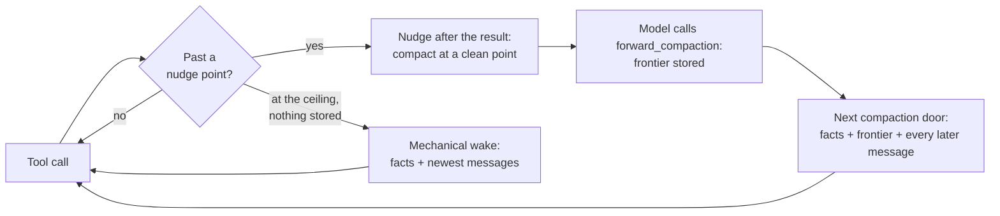

# forward-compaction — behaviour reference

This is the full behaviour of the plugin: every rule, limit and edge case the code holds. Start with the [README](../README.md) to install it and pick your settings; option defaults live only in the README's [Options](../README.md#options) table.

## What a compaction keeps

- ✍️ **The model writes the frontier, change by change.** `forward_compaction`
  takes `objective` and `next` as texts and `orders`, `decisions`, `done`,
  `remaining`, `blocked` and `findings` as numbered lists the model changes
  by item number; whatever a call leaves out stays. The plugin holds the
  frontier in files on disk, never summarized, and renders the wake from it;
  one with no objective or next, or one whose call ended at a field repaired
  from broken JSON, waits one request before it installs, and installs as it
  stands, its wake naming what it lacks.
- 🧾 **Facts are recorded, never reconstructed.** The user's messages (main
  chat) or the brief (sub-agent), the messages delivered to it, the skills
  loaded, the agents and the background shells come from typed hook events as
  they happened. Nothing is grepped out of a transcript or re-read from disk.
  A user's message is recorded once it enters main's conversation, from the
  row Claude Code appends (`session.append`, door `prompt`, `delivery` or
  `command`; ledger.ts `enteredOf`), never when Enter is pressed: a prompt
  typed over a running turn only queues, so one pulled back from the queue is
  never said, and one still queued when a compaction installs is not in that
  wake and is recorded once Claude Code delivers it. Each is recorded at the
  time its row entered, so the wake's oldest-first list is in the order the
  model read them; a prompt or delivery the plugin holds no submission for (one
  a plugin reload forgot) is recorded as the model read it, a delivery's
  reminder whole.
  Each party's newest prompts (the user's ten newest typed messages and every
  answer they gave to an AskUserQuestion, or a sub-agent's brief and the ten
  newest delivered to it) and the skills it loaded
  (the latest text of each) are also held in Claude Code's session state, so a
  plugin reload (`/reload-plugins`) does not lose them. Its frontier and its
  storage live in its files ([State on disk](#state-on-disk)), so a restarted
  or resumed chat keeps them with every number. The files touched and the task list come from each finished tool call.
- ⏩ **The messages after the call are kept.** The model need not stop after it
  compacts: the newest messages from the call on stay in the new context as
  they were, as many as fit, and any left out are named as not carried. Anything delivered between
  the call and the install that those messages lack (a notification of an
  agent or command finishing, the user's message, a coordinator's message)
  is carried in the wake under its own heading, as the model has not read it.
- 👥 **Every party.** The main chat and every sub-agent use the same tool;
  each has its own stored frontier, nudges, readings and ceiling. A model on
  the ignore list (Haiku by default) takes no frontier and is held to its
  ceiling, then compacted mechanically ([Ignored models](#ignored-models)).
- 🛟 **A ceiling as the safety net.** A party that never compacts is
  compacted mechanically at its ceiling: the same recorded facts and its
  newest messages, kept verbatim.
- 📜 **Every decision logged** to a JSONL file per session, and every step
  to a debug log, with the numbers as Claude Code's API gave them.

## How it works



A party's context is its last measured reading: the input, cache-read,
cache-write and output tokens of its last completed request, as `turn.step`
reports them. The nudge, the ceiling and the mechanical decision use it, so a
nudge may come one step late. No number is ever estimated from characters: a
party with no reading at all, none yet or none since an install, gets no nudge
and no ceiling, and an automatic ask from it with nothing stored is held as
`no-reading` until its next reading decides.

1. **Nudges.** Each party has a floor: its first context reading ever, or
   after an install the larger of its first two readings (the first sets it
   and marks it settling, the second makes it the larger, because only the
   second request after a compaction carries what Claude Code sends back: its
   skill, tool and agent listings), or any lower reading than a settled floor
   (a compaction this plugin did not make, after which the nudges and the
   finish notice start over as after an install); the plugin keeps it in the
   party's folder (`floor.json`, `{"floor": N, "settled": true|false}`). On
   load a floor without `settled: true` (an install's first reading alone, and
   every floor file an earlier version wrote) is not taken: the party's next
   reading is its floor.
   After a tool result, once the party's context has reached its nudge start
   (`FORWARD_COMPACTION_MAIN_NUDGE_START`, default `15%` of the max context;
   `FORWARD_COMPACTION_SUBAGENT_NUDGE_START`, default `165k` tokens, the same
   on every max context), the model reads one line saying how large its
   context is, in tokens. One more follows every
   `FORWARD_COMPACTION_{MAIN|SUBAGENT}_NUDGE_EVERY` of growth (default `5%`
   and `65k`). After an install the next nudge waits until the context has
   grown as much as the nudge start past the party's first reading (held to
   two `NUDGE_EVERY` below the ceiling, never under one `NUDGE_EVERY`).
   `FORWARD_COMPACTION_MAIN_NUDGE_ROOM` and
   `FORWARD_COMPACTION_SUBAGENT_NUDGE_ROOM` have no default: set, the party's
   first nudge goes out once its context has grown that room above its floor
   instead of at its nudge start, and after each install again that room
   above the new floor; the room is held to two `NUDGE_EVERY` below the
   ceiling so a nudge still comes before the mechanical wake, and is never
   under one `NUDGE_EVERY`. A set room wins over the nudge start, which then
   decides nothing and raises no start-below-the-ceiling warning. An invalid
   room is named in the options errors and the party has no room. The floor
   decides where nudges start only when a room is set. Each line is worded by
   its count since the party's last install, so no two read alike and each is
   firmer than the one before. The first three time the call between two
   steps, because a compaction drops what the model has read: the first asks
   for a frontier once the step in hand has its result saved and checked, and
   before it reads for the next step, the second the same as soon as that
   step is done, the third to start no new step and read nothing new; the
   fourth says to compact now, the fifth to stop, and from the sixth on the
   line names how many notices went unanswered. The last nudge before the
   ceiling, the one that one more `NUDGE_EVERY` of growth would carry to it,
   says instead that the plugin compacts next, with no frontier from the
   model. A nudge prints no list. A party holding a frontier is asked for
   only what changed since its last one, by item number: remove what is
   finished, lifted or wrong, edit what changed, add what is new; a party
   holding none is asked for a first frontier (objective, next, and what the
   rest of the work needs in orders, decisions, done, remaining and
   findings). Every line also routes material: what only a later step reads
   goes in `storage`, and `load_files` carries only what the next step reads.
   The first three close on the party's exception: a sub-agent's on when it
   may skip, as its work ends within a few calls, the main chat's on the
   finish rule below. No line names a max context or the ceiling. A held
   compaction ask adds no nudge of its own. After an install the party's
   first two readings settle its new floor and its level is absorbed silently (a
   sub-agent's floor of system prompt, tools and skills is already 55-60k), so
   the next nudge goes only when the context has grown by the nudge start (or
   the room, when set) above it. A wake lands near or above the old nudge
   level, and a nudge a few thousand tokens later makes the party compact in
   a loop. No nudge goes
   within one `NUDGE_EVERY` of the last one. A model on the ignore list gets
   no nudge. No call is ever refused or held back: a party that does not
   compact is compacted mechanically at its ceiling.

   The finish rule: the main chat also compacts when its whole work is
   finished, before its final report, with `remaining` "none" and `next`
   "write the final report". A finished chat otherwise holds a large context
   until the user replies, and a reply after the prompt cache expired
   re-sends all of it. The main chat reads the rule in its first three
   nudges, and before any nudge in one line of its own, the finish notice:
   once since its last install, when its context is at or past
   `FORWARD_COMPACTION_MAIN_FINISH_START` and one `NUDGE_EVERY` above its
   floor (`finishReached`), with no nudge sent yet and no stored call that
   compacts. A fresh or reloaded chat is held to the same rule from its first
   reading.
   A sub-agent is never asked: its context ends with its report. The plugin
   detects no finish and holds no turn end: the model decides.
2. **Compacting.** The model calls `forward_compaction` (the model sees
   `mcp__forward-compaction__forward_compaction`). The plugin applies the
   call's changes to that party's frontier, writes them to its files, and
   never refuses the call: an argument it cannot use is skipped, and the
   result names it. Whether the call also compacts is decided at the call
   (`callCompacts`, `Parties.compacts`) by the context reading that stands at the moment
   the call is judged, after the call's own writes (Claude Code measures the
   calling request while the call is answered, so a call in the first request
   after a compaction, or in a chat's first request, is judged by that
   request's reading), and the marks its notices go by: it compacts once the party's context has reached
   where a notice goes since its last install (main: its finish notice point,
   `finishReached`, or a nudge point; a sub-agent: a nudge point; a nudge
   point is the nudge start, with a nudge room set that room above the floor,
   and after a wake its room above the floor the wake left). Below that point
   the call only changes the held frontier: its lists, texts, storage and
   load_files are applied and written to disk, and nothing compacts: Claude
   Code's asks stay skipped (`compact` row, decision `skip`, why `waiting`),
   main's turn end does not compact, and nudges and the finish notice still go
   out when due. A party with no marks (window unknown), a party on the ignore
   list and a party with no reading yet are not judged and the call compacts;
   a woken party with no reading since its wake does not compact, a listed
   type below included. A sub-agent spawned as one of the agent types in
   `FORWARD_COMPACTION_SUBAGENT_CALL_COMPACTS` (comma-separated, trimmed,
   matched exactly, default none; `PartyState.type`, set from `agent.spawn`'s
   `subagentType` or `$.agent.list()`'s `type`; `Parties.typed`) is not judged
   by its context size either: `callCompacts` passes `always` to
   `Parties.compacts` and its call compacts at any size, for an agent whose
   definition tells it when to shed its context; it installs as any
   sub-agent's stored frontier does, at Claude Code's next compaction ask. The
   `start` decision row carries `subagentCallCompacts`. The stored
   call carries `compacts` (`StoredFrontier.compacts`), and the `stored`
   decision row logs `compacts: true|false` (`true` at any `tokens` for such a
   party); a later call from the notice
   point on applies on top of the earlier one and compacts. A second call
   before the install applies on top of the first. A frontier with no objective or next, or a call that ended at a field repaired from
   broken JSON, waits one request (see Installing) and then installs as it
   stands, its wake naming what it lacks.
3. **Installing.** A stored call that compacts installs at the next door Claude Code
   opens: for the main chat at the end of the turn (the plugin asks Claude
   Code to compact) or at an automatic ask if one comes first; for a
   sub-agent at Claude Code's next automatic ask. No summarizer request runs.
   A call that waits (`callWaits(missing, endedBroken)`: it leaves the frontier
   without `objective` or `next`, or its last argument was repaired from broken
   JSON or its whole unparsed input reads as cut, `ParsedCall.endedBroken`) stores `StoredFrontier.waits`; the first automatic ask after it is
   skipped (`compact` row, decision `skip`, why `unfinished`, built in `decide`
   from `DecideInput.waits`), so the party's next request can send the rest of
   the frontier; each further waiting call renews the wait, and the ask after
   that installs the frontier as it stands, its wake naming what it lacks
   (`Parties.waited(key)` marks the held ask as passed). A compaction the
   plugin starts itself (the main chat's turn end) and an ask that reports the
   request too long install at once and never wait. Nothing is refused.
4. **The ceiling.** An automatic ask with nothing stored is held. Once the
   party reaches its ceiling with still
   nothing stored, or Claude Code asks again with no response in between
   (its "prompt is too long" recovery), the plugin installs a mechanical wake.

### The tool

`forward_compaction({objective, next, orders, decisions, done, remaining, blocked, findings, storage, load_files, model})`,
with its schema in the prompt's tool list (not deferred), so a nudged model
needs no ToolSearch. The plugin holds each party's frontier as two texts and
six numbered lists, and a call sends only changes: whatever it leaves out
stays.

- `objective`, `next`: texts — what the work is for and what done means; the
  first concrete action after the wake. A text sent replaces the stored one,
  which goes to its history; one left out keeps it. The result says
  `objective set`, `objective replaced` or `objective unchanged` (the same for
  `next`), and `next kept: {text}` when the call left `next` out over a
  stored one. A blank text or one that is no string is skipped with a note.
- `orders`, `decisions`, `done`, `remaining`, `blocked`, `findings`: lists —
  the user's orders that bind the rest of the work, in the user's words; every
  ruling the user gave on how something gets done; the finished pieces, each
  with how it was verified; every step left, in order; what waits on whom;
  the party's own choices, errors verbatim, the commands it will need again.
  Each takes one object `{add, remove, edit}`, every key optional: `add` an
  array of texts, `remove` an array of item numbers, `edit` an array of
  `{id, text}`. In `remaining` alone an `add` entry may be `{before, text}`:
  the new step is shown before the live step with that number, or last, with
  a note, when that number is not live.
- An item's number is per list, starts at 1, never shifts and is never
  reused, across restarts too. In one call a list's removes and edits apply to
  the numbers the model saw, then its adds; a number both removed and edited
  is removed, with a note. An edit replaces the item's whole text and keeps
  its number and its place; an edit to the text it already holds is a note.
  An added text equal to a live item of the same list, compared with its
  spacing collapsed and in lower case, is skipped as `already [n]`.
- An order is removed by its number in `orders.remove`, with no proof asked.
  The live orders open every wake ([The wake](#the-wake)). The model removes
  one the user lifted and, by itself, one given only for an objective now
  reached: the `objective` field's description has the call that sends the
  next objective review every order, and the `orders` field's leaves every
  other order to the user. The plugin ties no order to an objective and
  removes none itself.
- The call is never refused. A plain text sent to a list is one added item (a text that is only an
  operation's name excepted, below), and an array sent straight to a list its adds; a single number or `{id,
  text}` where an array was due is read as one; a number that is not live, a
  blank text or a malformed entry is skipped. Each is answered by one note
  naming its place (`done.remove[1]: [9] is not a live item: skipped.`).
  `standing_orders` entries are taken as `orders.add`; `lifted` is answered
  with a note naming `orders.remove`; `keep_skills`, `drop_files`,
  `drop_skills` and a load file's `later` are ignored with a note. A field
  the tool does not take joins `findings` as one item,
  `[{name}, an argument forward_compaction does not take]` then its value,
  and the note lists the fields; one that holds nothing (null, a blank text,
  an empty array or object) is ignored, with a note.
- A list, `storage` or `load_files` value that arrives as the text of its own
  JSON is read as that JSON, with one note. A value whose JSON does not parse
  is repaired (`repairJson`): its brackets balanced (a closer missing, a
  closer misplaced, a string left open), bare `add:`/`remove:`/`edit:`
  operations braced (operations named by leaked tool-call tags,
  `<parameter name="add">[…]</parameter>`, the closing tag optional and a
  namespace prefix before `parameter` allowed, are read the same way, with the
  same note; a tag inside an item's string stays text), and a value closed early read together with the
  arguments written after it inside the same text; each repaired field gets
  one note. A repaired field that is the call's last argument makes the call
  wait one request before it installs (`callWaits`, `ParsedCall.endedBroken`): a
  model's response can end right after a leaked tool-call tag, so the call
  arrives carrying only its first fields. A repaired field with an argument
  after it ended nothing, and its call installs like a whole one: held one
  request, a main chat's reply to the user is written before the install and
  kept behind it, where the user reads it twice. A list sent as an object
  that holds other fields beside its operations
  (`done: {add: […], findings: {…}}`) gives each up as its own field, with one
  note; a key that is no field, or a field the call also sent, leaves the
  object as it arrived. A call whose whole input did not parse reaches the
  tool from Claude Code as `{__unparsedToolInput: {raw, len}}`, `raw` the text
  the model wrote: `unparsedCall` balances its brackets and the call is read
  from the result like any other, with one note; a text no repair reads joins
  `findings` whole (`[this call's arguments, as they arrived]`), with a note
  asking for the arguments again. Such a call waits unless its text closed
  its own object, or its end is one closer short and its last argument held a
  field written after its operations: there the model dropped that list's
  closer and wrote on, so nothing after it is missing. An item's text loses a number the model typed before it
  (`[9] Parser merged`); an edit's text only its own number. A list's text
  that is an empty array or object changes nothing. A text that is no
  JSON stays one added item, except a text that is only an operation's name
  (`add`, `remove` or `edit`, any case, spaces around it ignored): it changes
  nothing and is answered by the note `{list} was only the word "{op}", an
  operation with no item: nothing changed.` A field taken back out of a text that holds
  its own closing tag then `<parameter name="…">` (the model's call markup
  closed it early; a list, `storage` or `load_files` field is read as JSON, a
  list one that is no JSON as text) is one note; one that cannot be (no
  field, one the call also sent, or a `storage` or `load_files` one that is
  not JSON) stays in the text it arrived in, under
  `[{name}, as it arrived inside {field}]`.
- `storage` (optional): `{add, remove}`, markdown files the party keeps for a
  later step and reads or edits itself with Read and Edit, by the absolute
  path the wake gives. `add` takes `{name, description, value}` entries: a
  name is lower-case letters, digits and dashes ending `.md`; one sent
  without `.md` gets it, and another is rewritten to that form (`API Survey`
  → `api-survey.md`) and cut to 100 characters before `.md`, the result
  naming the name stored. The value is
  written whole, with no size cap, and the entry listed: `Stored {name} ({n}
  characters)`. An existing file is overwritten after its old content is
  copied to the history. An `add` without `value` changes a listed entry's
  description only (`Described {name}`), lists an unlisted file already in
  the folder (`Stored {name} ({n} characters, as it is in the folder)`),
  copies one the model wrote there under another spelling of the name to its
  storage name (`Stored {name} ({n} characters, copied from {file} in the
  folder)`), and is skipped with a note when there is no such file. `remove` takes names:
  each entry is unlisted (`Storage no longer lists {name}`) and its content
  copied to the history, a name already there numbered before `.md`
  (`survey.2.md`); a value the same call wrote is the one copied when that
  call overwrites or removes it. The plugin's file API (`$.fs`) has no move or delete, so
  the removed file stays in the storage folder, unlisted.
- `load_files` (optional): `{path, lines?, why?}` entries, as many as the
  party needs, each a path to a regular file, `lines` a range like `10-40` or
  `1-60,160-185`, `why` one line. A call that sends `load_files` replaces the
  earlier call's; one that leaves it out keeps them. A relative path is
  resolved against the session's directory (`$.session.cwd()`), or carried as
  given when that read fails; a `why` past 200 characters is cut to 200, and
  a missing one carries the file without it; `lines` that are no range carry
  the file from line 1. Only an entry with no path is skipped. Their size
  never refuses the call. Each file is read when the frontier installs and
  carries at most 250 lines: of its `lines` ranges when given, else from
  line 1. A file holding a NUL character is binary: it is named as `not a
  text file` and never carried. When lines are left past the 250th, the
  file's block ends with one line, `[N more lines not carried: Read {path}
  from line L]`, N the lines left in the ranges or the file and L the next
  one. There is no room for the files together. A file that is missing, or
  whose ranges hold no line, is named under `## Files not carried` with why.
- `model` (optional): the model the main chat continues on, sent only when
  the user asked for it in their own words ([A model
  switch](#a-model-switch)); one line after the install line says what
  happens with it.

Each call's changes are applied and written to the party's files when it
arrives ([State on disk](#state-on-disk)), so the result can give numbers; a
second call before the install applies on top of the first. The result is
one line per change, then the notes, then the sizes, then when the frontier
installs:

- `Added to {list}: [7], [8]`, `Removed from {list}: [2] {its text}`,
  `Edited in {list}: [4], was: {its old text}`, `Skipped in {list}: already
  [3]`, and the texts' and storage lines above; an item that left (removed,
  or the text an edit replaced) shows its first 80 characters, then `…`, its
  whole text staying in the list's history file;
- one note per skipped, malformed or unknown entry, naming the field and the
  place, and per `load_files` entry resolved from a relative path, with a cut
  or bad `why` or bad `lines`, absent, not a regular file or that could not
  be checked; a call with no `tool_use_id`, which the wake cannot place, is
  named too;
- per file the plugin could not write, `Not saved to disk yet: {list, text or
  storage entry} ({the error, the path of a list's, text's or history file
  replaced by …, a storage file's keeping its place in the folder}); it is held
  and saved again at your next call.` The change stays applied in memory,
  the error is logged and shown on screen, and the next call writes it again.
  `done-earlier.md` or its record `done-earlier.json` not written is logged
  and shown on screen only: the result names nothing, and while the file does
  not hold what it should the result has no done line and the wake shows the
  whole done list;
- `Frontier: {n} characters in {m} items ({list} {n}, …)`, counting every
  live item, the objective and next, listing the lists that hold items;
  past `FORWARD_COMPACTION_FRONTIER_WARN_CHARS`, a frontier with no list
  item also gets `Frontier is {n} characters, over {threshold}: in your next
  forward_compaction call send a shorter objective and next.`; one whose
  lists hold items is asked nothing. Nothing is cut and no call is refused;
- `Done: {S} newest items stay in your wake, {N} earlier in {absolute path}`
  (`1 newest item stays` for one),
  after the size line(s) when done holds items its wake names instead of
  showing ([The wake](#the-wake)) and `done-earlier.md` holds them; the size
  line still counts the whole frontier;
- `Storage: none`, `Storage: 1 file (notes.md)` or `Storage: 2 files (survey.md,
  gate-recipe.md)`, on every call after the size and done lines and before the receipt
  sentence: the listed storage files by name, in listed order;
- a call that does not compact: `Frontier updated{…}. Nothing compacts: your
  context is still too small for a compaction to pay, and stays as it is. Carry
  on; a forward-compaction notice asks for the call once it has grown enough.`
- `Frontier stored`, with `with {n} files to load` when it carries any, and
  `, without {objective|next}: send it before it installs, or the wake names
  it missing` when the frontier holds no objective or next; `A broken field can
  end a call early: if the lines above lack something you meant to send, send
  it before it installs.` when the call ended at a repaired field; then when it
  installs — for the main chat at or past Claude Code's ask point, inside
  this turn, before its next request (`It installs before your next request,
  inside this turn: what you have read is gone then, and the rest of the turn,
  your reply to the user included, is written from the frontier. The newest
  messages after this call that fit are kept verbatim behind it, the rest
  named as not carried.`), for the main chat below the ask point at the end of
  this turn or at Claude Code's next ask if one comes first, for a sub-agent at
  Claude Code's next ask (with where that ask comes) — and, when an earlier
  call since the last wake was stored, `This call applied on top of your
  earlier one since the last wake.` For a call that waits, the installing
  sentence says so: the main chat past the ask point, `It installs after your
  next request, inside this turn`; the main chat below it, at the end of this
  turn or at Claude Code's second compaction ask from here if that comes
  first; a sub-agent, after its next request, or at Claude Code's second ask
  when none has come yet. It prints no context size: the plugin
  measures none for that moment.

A frontier with no objective or next installs at the same doors as a complete
one, one request later (see Installing): the frontier message names what it lacks and says to re-establish it
from the user's messages (main) or the brief (sub-agent) and send it in the
next call, and a warning row names it. The decision log's `stored` row and
the installing `compact` row name it as `incomplete`.

Every answer ends with one line saying the
plugin is experimental and asking the model to append a short note of any
trouble to `issues.md` in the level-log directory (the reply itself when no
directory resolves).

### The wake

The installed context is, oldest first: a sub-agent's start, one facts
message, one frontier message, then the messages after the call, returned as
Claude Code holds them. The start is the user messages the sub-agent's
transcript opens with (its brief, with what Claude Code attached to it),
handed back untouched by handle, then one fixed assistant line, `My context
was compacted here. What follows is the record of my work and my frontier as
forward-compaction holds them.` (`START_END`). A compaction that follows
another within the prompt cache's lifetime reads the start from the cache
instead of writing it again. A transcript that opens any other way (a wake
built without a start) has none, and its facts carry the brief. The main
chat's wake has no start: facts, frontier, tail. The frontier message carries the call's own result, since the install
replaces the message that held it, and, like a mechanical wake's message,
ends with the experimental line and where to note any trouble.

On screen the two built messages are user-role rows, which Claude Code's
fullscreen view draws whole. Outside the expanded view (the ctrl+o
transcript, `--verbose`, an export) the plugin draws nothing for the facts
message and one dim line for the message after it:
`forward-compaction installed the frontier, 135k → 58k context, its first request read 11k from the prompt cache and wrote 47k: the transcript view (ctrl+o) shows it and the recorded facts in full`,
or for a mechanical wake
`forward-compaction compacted mechanically, no frontier was written, 135k → 58k context, its first request read 11k from the prompt cache and wrote 47k: the transcript view (ctrl+o) shows its note and the recorded facts in full`.
The sizes (`landedShort`) are the party's last reading before the install and
its first after it, as Claude Code reported them; a missing reading before is
said as `unknown`, and the cache clause appears only when that request's usage
reports both counts. Until that request arrives the line stands without the
sizes (`forward-compaction installed the frontier: …`), and the plugin asks
Claude Code to draw the rows again when they are known
(`$.ui.invalidate('ui.render')`).
The fold is a drawing only: the stored messages, the ones the model reads,
keep every character, and the expanded view draws them as Claude Code does.
A row folds only when Claude Code marks its message as built by a hook
(origin `unclassified` in the main view, `coordinator` in a sub-agent's view,
where it sits under "From main") and it opens as a wake message does, so the
same text typed or pasted by the user is drawn whole.

A `forward_compaction` call's own row is drawn the same way (`callRow`,
`callResultRow`, `call-row.ts`). Outside the expanded view the call's row draws
what the call did in place of its raw arguments, and the result block under it
draws nothing. The block draws every part of the frontier on every call,
changed or not, empty or not (`statLines`, `callStats`):

```text
● forward_compaction  frontier updated · nothing compacts, the context is still small
  ⎿  orders     0
     decisions  0
     done       1    +1 [1]
     remaining  0
     blocked    0
     findings   1    +1 [1]
     objective  set
     next       set
     storage    1 file: notes.md  +notes.md
     load_files none
     wrote      221 chars of arguments · its request wrote 208 tokens
     frontier   70 chars · 2 items
     context    73k at the call
```

and a call that leaves the frontier as it was:

```text
● forward_compaction  frontier updated · nothing compacts, the context is still small
  ⎿  orders     0
     decisions  0
     done       1
     remaining  0
     blocked    0
     findings   1
     objective  unchanged
     next       replaced
     storage    1 file: notes.md
     load_files none
     wrote      15 chars of arguments · its request wrote 62 tokens
     frontier   61 chars · 2 items
     context    74k at the call
```

A call that compacts has the same block under the head `frontier stored ·
compacts {when}`.

- The head line: `writing the frontier` while the call runs; `frontier stored ·
  compacts {when}` with the receipt's own words for when; `frontier updated ·
  nothing compacts, the context is still small`; and `· without {objective|next}`
  when the receipt names one missing.
- The six lists `orders`, `decisions`, `done`, `remaining`, `blocked`,
  `findings` come first, in that order, each with the number of items it holds
  (a dim `0` when empty), then its changes when the call made any: `+` added
  (green), `~` edited (yellow), `-` removed (red), each with its count and item
  numbers.
- `objective` and `next` read `set`, `replaced`, `unchanged` (dim) or `missing`
  (red, when the receipt names it missing).
- `storage` reads `none` (dim) or `{n} file(s): {names}`, followed by `+name`
  stored, `~name` described, `-name` no longer listed, and `not reported`
  (dim) for a result written by a build before the storage line. `load_files`
  reads `none` (dim) or `{n} read in at the install`.
- `wrote` is the characters of the call's arguments as JSON, plus the output
  tokens of the request that made the call when Claude Code reported them;
  `frontier` is `{n} chars · {m} items`; `done split`, a row of its own drawn
  only when the result has its done line, is `{S} newest in the wake · {N}
  earlier in done-earlier.md`; `context` is that request's context
  reading. The two token figures are Claude Code's readings for the request
  (`turn.step` usage), never estimates, and are absent until the step reports.
- A call that failed, errored or was interrupted, the expanded view, and every
  other tool keep Claude Code's own drawing. The stored result the model reads
  is unchanged.

The facts message opens with the plugin version that built the wake
(`compacted by forward-compaction 2.2.5`), so a chat on an old build shows
it; a sub-agent's with a kept start adds `Your brief is the first message
above, kept verbatim.` It holds, each section only when it has content:

- the standing orders, first, under `## Standing orders — each binds until
  the user lifts it or the objective it was given for is reached`: each live
  order on its own line as `[n] text`, with the
  unchanged tag the frontier message describes, carried whole, outside the
  budget. A mechanical wake carries them the same way,
  and the frontier message and the mechanical wake's message both say to
  continue within them;
- what arrived after the frontier and the kept messages lack: every
  notification, message from the user or the coordinator, and message that
  resumed a sub-agent, verbatim, first;
- plan mode and the plan file, when the party's plan-mode attachments
  (Claude Code's `prompt.attachment` rows `plan_mode`, `plan_mode_reentry`,
  `plan_mode_exit`) named them, as Claude Code's own compaction carries them:
  `## Plan mode` while the party is in plan mode, naming its plan file, and
  `## Plan file` with the file's path and its content read whole at install,
  in plan mode or after it ended; a plan file not written yet is left out,
  one that could not be read is named. Both are carried whole, outside the
  budget;
- the brief (sub-agent), verbatim under `## Your brief`, only when the wake
  has no kept start (with one, the brief is the first message above and no
  section repeats it), or the user's newest ten typed messages
  and every answer they gave to an AskUserQuestion, however old (main chat),
  oldest first, always carried whole, whatever their size. An answer, which
  reaches the model as the tool's result, never as a prompt, is headed
  `(the user answering your question)` and holds each question, its
  `Answer:` and any `Notes:`. The heading counts what is carried of the messages
  the plugin recorded (`N of M recorded`; a restart begins the record again),
  the answers among it, and the oldest recorded typed messages left out, which
  look_back finds. A
  wake carries text only: each `[Image #N]` in them reads
  `[Image #N] (image not carried: the wake cannot hold images)`. A resumed
  sub-agent's resuming message is a delivered message, never part of its
  brief;
- the documents the sub-agent's brief names (sub-agent, every wake), read from
  disk at install under `## The documents your brief names, read at install`
  (`BRIEF_FILES_HEADING`), its first line `They are part of your brief: where
  your frontier words one of their rules differently, their words hold.`
  (`BRIEF_FILES_NOTE`), then one `### {path}` block per document (` lines 1-N`
  after the path when cut). A kept start holds the brief word for word, but a
  brief that hands its rules to a file would lose that file's text with the
  dropped context. A document is picked (`briefFiles`, `src/brief-files.ts`)
  when its path is named in the brief, absolute or under `~` once the home
  directory is known, and ends in one of `BRIEF_FILE_EXTENSIONS` (`md`,
  `markdown`, `txt`, `rst`, `adoc`); one of the sub-agent's own calls opened it
  (a Read of it, or a shell command naming it as a whole path); the sub-agent
  did not write or edit it; and its frontier does not list it in `load_files`.
  Source, data and log files a brief names are never carried this way. They
  are read in the brief's order, all together within `BRIEF_FILES_MAX_CHARS`
  (`LOAD_FILE_MAX_CHARS`, 40,000 characters), outside the budget below: one that
  fits what is left is carried whole, the one that crosses it is cut at its
  last line that fits and ends with `[N more lines not carried: Read {path}
  from line K]`, and one with no room left, or unreadable, empty or binary, is
  named under `## Files not carried` with its problem;
- the newest ten messages delivered to the sub-agent (its coordinator's, the
  returns of the agents it started, and the notifications that resumed it) or
  the notifications delivered (main chat); one delivered into a running
  sub-agent is recorded from the row Claude Code appends as it delivers it
  (`session.append`, door `delivery`), as the model reads it, and one that
  resumes it from the turn it starts;
- the results of the tool calls made in the same response as the frontier;
- the skills and commands the party loaded, the latest load of each, newest
  first. Only a pinned one (its file's frontmatter sets
  `forward-compaction-keep: true`, `FORWARD_COMPACTION_KEEP_SKILLS` names it,
  or that list holds `*`) is carried whole, under `## Skills in force, as
  loaded`, its heading saying `pinned`. Every other one is listed under
  `## Skills not carried`, after one sentence saying its text is gone and the
  `Skill` tool loads it again, as `- {name} ({source}, {path}): {description}`,
  the description its frontmatter's, left out when it has none. A sub-agent's
  skills follow the same rule as the main chat's. The skills carried whole
  stay within Claude Code's own limits after its compaction: newest loaded first, each cut past 20,000
  characters to its first characters and Claude Code's marker
  `[... skill content truncated for compaction; use Read on the skill path if
  you need the full text]`, and all of them together within 100,000
  characters (Claude Code's 5,000 tokens a skill and 25,000 in all, at its 4
  characters a token: design budgets in characters, never a measured token
  count). A skill that does not fit what is left is skipped, and a smaller one
  after it may still fit; each skipped one is named under `## Skills not
  carried` with the `Skill` call, and the path to `Read` when known, that
  loads it again. A skill Claude Code loaded
  without saying which party loaded it is named, not carried, in every
  party's wake, with the call that loads it again;
- the files the party touched, newest first, at most 15 paths, each tagged R
  read, E edited or W written (its strongest touch), from its finished `Read`,
  `Edit`, `MultiEdit`, `Write` and `NotebookEdit` calls; a denied or failed
  call touched nothing;
- the shell commands the party ran, newest first, under `## Shell commands
  you ran, newest first`: each finished `Bash` call's command verbatim under its
  `description`, a failed one too (it is the command to rerun), a denied one
  never, never their output; at most 20, a command run again kept at its
  newest run, the older ones named as not carried;
- the task list as last set, from `TodoWrite` or `TaskCreate`/`TaskUpdate`,
  whichever moved last, carried whole, never fitted;
- the agents, listed at install (at most 50 rows): for main every agent, for a
  sub-agent only the agents it spawned (`parentId` its own id); then each agent
  the party spawned that the list no longer holds, as `not in the list
  (finished, stopped or gone)`, so a frontier's "still running" is not
  trusted; past the cap the newest of those stay;
- the background shells and crons, from the newest Stop event, with its age;
  before any Stop event it says the running shells are unknown. Main's wake
  (`## Background shells and crons (session-wide, from the Stop event {age}
  before install…)`) lists every task and cron of that snapshot. A
  sub-agent's (`## Background shells and agents you started (from the Stop
  event {age} before install…)`) lists only the tasks tied to it: a shell
  whose command equals a command one of its own Bash calls sent (a Stop event
  names a shell by the command its call sent) and an agent it spawned; crons
  are not listed. Every other task and cron of the session, the sub-agent
  itself left out, is counted in one line with no id and no command, `(not
  listed: N other background task(s) or cron(s) of this session, not recorded
  as yours)`, absent when N is 0 (`Facts.otherTasks`; the filtered
  `Facts.shells`). The heading's "started since" count counts only the
  sub-agent's own background commands; main's counts every party's. The
  commands a party ran are held in memory only, so after a plugin reload a
  shell the sub-agent started before the reload is counted, not listed;
- the files the frontier asked to carry, each at most 250 lines;
- the storage, when it lists an entry, under `## Storage — files in
  {absolute storage folder}/`: one line per entry, `{name} — {description}`;
- the load files not carried, with why;
- in a mechanical wake only, under `## Files you were working on, newest
  first, read at install`: the 5 newest files the party touched, a document
  carried under the brief's documents above left out so it appears once, read from
  disk at install, each at most 250 lines with the same `[N more lines not
  carried: …]` line and at most 40,000 characters, a longer one ending `[cut
  at 40000 characters: Read {path} for the rest]`, as Claude Code's own compaction restores its 5 most
  recent files because it fires uninvited. One that could not be read is
  named in place with why. A frontier's wake carries only the files the
  frontier asked for, and the wake an error falls back to, built without
  any read, carries neither these files nor the plan file.

Its size, a sub-agent's start counted whole, is held to a budget of half Claude Code's ask point (the
`autoCompactThreshold` that `$.session.usage` reports, held at or below the
party's max context: 31,500 tokens at `CLAUDE_CODE_AUTO_COMPACT_WINDOW=100000`),
turned into characters at the party's measured characters per token: the
characters over the tokens it has grown since its base, its live window's
characters (from `$.session.messages({ as: 'api' })`, the messages its next
request is built from) and reading at its first reading since it started or
was last compacted, so the system prompt, tools and skills every reading
counts cancel. It is unmeasured until the reading has grown 5,000
tokens past the base, or outside 1 to 8 characters a token, and unmeasured
nothing is fitted: a frontier's wake carries the facts, the files and every
message after the call, and a mechanical wake keeps no earlier message. The standing orders, the brief or the user's newest ten typed messages and every answer,
the brief's documents (within their own 40,000 characters) and the task list are carried whole, outside the budget; the skills and
commands within their own limits above, the plan file whole, and the files
each within 250 lines, are outside it too. Every other section has a share — what arrived after the frontier 25%,
delivered messages or notifications 5%, sibling results 10%, the shell
commands 5% — and is carried whole or named as
not carried, never cut. The room left goes to the messages after the call: the
oldest are dropped whole until the rest fits, and the frontier message says
how many were dropped.

The frontier message opens `[forward-compaction: frontier] Below is your
frontier as forward-compaction holds it: continue from its ## Next`, with
`, within the standing orders above` while an order is live, then `When a
notice next asks for a forward_compaction call, send only changes, by item
number; whatever you leave out stays.` The frontier follows, rendered from the lists, never from
text the model wrote whole: `## Objective`, `## Decisions`, `## Done`,
`## Remaining`, `## Next`, `## Blocked`, `## Findings`, each list's live
items one per line as `[n] text`, a list with no item left out. Done shows
only its newest items while their texts fit `FORWARD_COMPACTION_DONE_MAX_CHARS`
(default 12,000 characters): walking from the highest number down, an item is
shown while the shown items' texts sum to at most the cap, the newest always,
even alone over it; every older item is earlier. The earlier items stand whole
in `done-earlier.md` in the party's folder, each as `[n] text`, oldest first,
with no tag, and Done opens with one line naming it, before its shown items:
`{N} earlier done items, [{lowest}] to [{highest}], are in {absolute path},
each whole under its number: finished work like the items below, edited or
removed by number like them. Read the file when a step or the final report
may rest on one.`, or with one, `1 earlier done item, [{n}], is in {absolute
path}, whole under its number: …`. The split is made at each rendering, the
frontier wake and the mechanical wake alike: `data/done.json` keeps every
item, so `edit` and `remove` reach an earlier item by its number as they
reach a shown one, and only done is split. The plugin writes the file
whenever what it holds may have changed (each call, each compaction ask,
each `floor.json` write) and before a wake names it. The file always holds the earlier items, and a call
takes no live item out of it: its rewrite holds the earlier items and every
live item the file already held, oldest first, each at its current text, and
only a removed item leaves. An item the party's wake named and did not show
so stays readable there when a later call leaves it no longer earlier (the
newest item removed, an item edited shorter, the cap raised). The file is the
earlier items alone again once the party has read a wake that shows the rest.
A rendered wake is not yet one the party read: it is handed to Claude Code,
whose ask can be abandoned, and the handling of an ask can fail after the
rendering. So the file gives up the items a wake showed only when a later
compaction ask's transcript holds that wake, at the party's next write after
it. `done-earlier.json` beside the file records the highest done number the
file holds (`{"through": N}`), written before the file gains an item and
after it gives one up, so the record never names less than the file holds and
a restarted party's rewrite drops nothing. With no record the file holds
none; a record that cannot be read is logged and never read as none: the file
then holds every live done item until the party has read a wake that shows
them. A wake shows the split only while the file is known to hold what it
should, and the whole done list when the file or its record could not be
written. With no item to hold, a file that exists is rewritten to say it
holds none. An item of
any list, an order included, ends with `[N rounds unchanged]` (` [1 round
unchanged]`) once N compactions were installed since it was added or last
edited, and with nothing before its first. The plugin counts the rounds, the model writes
none, and a tag sent back at the end of an add or edit text is stripped.
Where a tag shows, the opening line adds `An item tagged [N
rounds unchanged] has passed N compactions with no change: keep it only
while it is still true and still needed, and a standing order while it
binds.` The objective, the next and the storage entries carry no tag. A
frontier with no objective or next names what it lacks; then the message says how
many later messages follow. No model-facing text names the path of a list's
file or of the history; `done-earlier.md` and the storage folder are the
files of the party's folder a wake names. A mechanical wake replaces it with a message saying
how many of the newest messages were kept and how many are gone. With no
frontier held it says the party had not called `forward_compaction`, and to
re-establish the objective and next step from the user's messages or the brief.
With a frontier held it says the context reached the ceiling before a
`forward_compaction` call compacted it, and shows the frontier as the party's
last call left it: what the party did after that call is missing from its Done,
Remaining and Next and shows in the recorded facts (files touched, shell
commands run, messages). It says to continue from where the messages leave off,
or from its Next less every step the facts show done, and to bring the frontier
up to date at its next milestone with one call sending only changes by item
number.

Each install writes one line, measured: it waits for the party's first
reading after the install, and is an info row in the logs, never on screen.
A frontier the model chose:
`main frontier landed — 164k → 46k context, measured; 4,812 characters, 3 facts, 5 messages kept verbatim.`
A mechanical wake:
`Explore 3f2a9c had no frontier at 125k (ceiling 120k) — mechanical wake installed, 125k → 38k context, measured.`
Before is the party's last reading before the install, after its first one
since. A party that ends before a request measures it gets its line at its
end, with after said as unknown, never guessed.

### What else happens at a compaction

- A user's `/compact` runs Claude Code's own summary untouched; a stored
  frontier that compacts is dropped, and the screen says so; one that does not
  compact says nothing, as there was no install to lose.
- A message the user sends after the call does not cancel a stored frontier:
  it is among the messages kept after the call.
- A stored frontier whose call is no longer in the party's transcript
  (something else compacted it), or that came with no `tool_use_id`, still
  installs: it is carried with the newest messages that fit, as a mechanical
  wake keeps them (none when no ratio is measured), the frontier message says
  which messages followed the call is unknown, and a warning row names it.
- An engine loop that is not one of the session's sub-agents (a fork Claude
  Code runs itself) is left to Claude Code.
- A `precompute` ask is skipped: it is never used.
- An error inside the compaction hook never reaches Claude Code: the plugin
  installs a mechanical wake instead, built without any read, and if that
  fails too, Claude Code's own summary runs. Either way the error is on the
  screen.
- When the main chat's turn-end install is skipped or rejected, the frontier
  stays stored for the next turn end or ask; a skip is a warning row
  (`turn-end-skipped`), a rejection an error row (`turn-end-rejected`) said on
  screen.
- A party's context that falls to half or less with no compaction this
  plugin handled (another plugin or Claude Code compacted it) is a warning
  row (`unseen-compaction`).

### A typed /compact written by a fork

With `FORWARD_COMPACTION_MAIN_FORK` on, a `/compact` the user types in an
idle main chat gets a frontier a fork writes (`src/fork.ts`). The model writes
its own frontier everywhere else: nudges, the finish notice, every automatic,
plugin-raised, precompute and reactive ask and the ceiling are decided as with
the option off, and sub-agents and ignored models never fork.

- Idle (`forkIdle`): main's newest assistant message or tool result is an
  assistant message with no tool call. A `/compact` typed while a turn runs
  goes to Claude Code's own summary, the stored frontier dropped.
- The ask (`decide`, decision `fork`, why `manual`) awaits `$.model.fork`
  with a fixed prompt (`forkPrompt`): the turn-end stand, the text typed
  after `/compact` when the ask carries it (`The user typed this with
  /compact: …`), the stored frontier, every list numbered as a wake shows it,
  `done` split as the wake splits it; the storage entries; the fields of the
  tool's own schema; and how to write the changes. The stored frontier is not
  dropped: the fork brings it up to date. The fork names
  `FORWARD_COMPACTION_MAIN_FORK_EFFORT` when it is set.
- The reply's first top-level JSON object (`forkReply`; a code fence or prose
  around it noted, broken JSON repaired by `repairJson`) is stored as one
  `forward_compaction` call through the same door a model's call uses: its
  `stored` row has `writer: "fork"`, and it never waits. The ask installs it:
  its `compact` row has decision `install`, why `fork`.
- The wake after a fork is a frontier wake: main's last assistant message
  (`forkTrailing`) and every one after it kept verbatim, fitted as the
  messages after a call are, the fork's `load_files` read in, and the same
  closing instruction.
- A failure never holds the `/compact`: nothing to fork, an abort, an API
  error, an empty reply, a reply holding no JSON object, a call that threw, a
  reply the store did not take, or a Claude Code without `$.model.fork` (its
  `TypeError`, outcome `no-fork`) each end in Claude Code's own summary with
  the stored frontier dropped; the `compact` row carries `fork:` with the
  outcome, and one screen line says the fork failed and Claude Code's own
  compaction ran, and that the stored frontier was dropped when one that
  compacts was (its `dropped` row a warning).
- Each fork writes a `fork` row: trigger `manual`, the outcome (`applied` or
  the failure), its wall time, the effort sent, the reply's usage whole
  (input, cache read, cache written, output), the prompt's and the reply's
  characters; a failure is an error row, its start and an applied fork info
  rows. A `fork-prompt` debug row carries the prompt's section sizes.

### A model switch

- A main chat call carrying `model`, a model name or alias, asks that main
  continue on that model. The switch never costs a prompt cache: it begins at
  main's first request after main's next compaction that the plugin knows of
  before that request leaves, whose new context has no cache yet; it never
  forces a compaction. A call below its notice point compacts nothing, and the
  switch waits; a call that leads to a compaction (a fork's always does) waits
  for that one. The doors that arm it: this plugin's wake or mechanical wake,
  and Claude Code's own summary, each once the `session.compact` result
  handed back holds the compacted `messages` and its hook was not aborted (a
  skip compacted nothing, and an aborted dispatch went on without the hook's
  result). A compaction no hook of this plugin handled, seen only by the
  fall of the request after it (`unseen-compaction`), starts nothing: that
  request already went out on the model main is on and cached the new context
  there, and a rewind falls the same with its old cache alive; the switch
  waits for a later compaction. The result's line after the install line says
  when: `model {name}: taken; you continue on it from the first request after
  your next compaction, and stay on {model} until then.` for a call that
  compacts nothing, `model {name}: you continue on it from the first request
  after this compaction.` for one that compacts.
- A name main is not on is set only once Claude Code answered one trial
  request naming it: a request rewritten to a name Claude Code does not serve
  is dropped and run again on its fallback model. After the frontier is
  stored, the call awaits `$.model.complete` with `SWITCH_TRIAL`
  (`src/model-switch.ts`: the prompt `Reply with the single word OK.`, a
  4-token reply cap, a 30 s limit), which counts toward the session's cost. A
  trial not answered (an API error such as `model_not_found`, an empty reply,
  no answer within the limit) or rejected (a name outside the user's model
  allowlist) changes nothing: the result's line is `model {name}: not taken
  ({why}); you stay on {model}.`, and one warning screen line says `main stays
  on {model}: a trial request naming {name} was not answered ({why}).`,
  `{why}` as Claude Code gave it. A sub-agent's call, a non-name, the model
  main is on, and Claude Code's own model asked back during a switch run no
  trial; a failed trial is not tried again.
- The switch rewrites each of main's requests in the `turn.step` hook: the
  request goes out naming the asked model in place of the one Claude Code
  named. Claude Code's own model is untouched, so its header and `/model` keep
  showing the earlier model; no setting is written, and the saved default of
  new chats stays. A fork of main (`agent.spawn`'s `fork`) spawned while the
  switch is active shares main's cached prefix: each of its requests named
  the switch's `from` goes out on the switched model for the fork's whole
  life, and so does each of a fork spawned by such a fork
  (`parentAgentId`). A fork spawned while the switch only waits, or with no
  switch, had its context cached on Claude Code's model and is never
  rewritten, also once main switches later. Each follow is kept in main's
  `model-switch.json` (`forks`, by agent id), so it holds across
  `/reload-plugins` and a restart, a resumed fork keeping the follow it had
  (a resume starts none), and it outlives main's switch: a fork that followed
  keeps its model after main's switch ends. A spawn can be the first hook
  after a plugin reload, what main kept not restored yet: the fork's follow
  is then taken as that restore lands (failed too), the spawn not waiting for
  it, before any request that waited for the restore goes on; a fork whose
  parent's request went out unswitched meanwhile follows nothing. A fork's
  answers never begin or end main's switch. Any other
  sub-agent's request is never rewritten, and a sub-agent that inherits its
  model still gets Claude Code's.
- Out of the switch's reach, as no hook is handed their request: Claude
  Code's prompt suggestion after each turn (`prompt.suggest` fires once its
  text exists, and `turn.step` never sees its request), its own summary at a
  typed `/compact` (`session.compact` carries no model) and `$.model.fork`
  (no `model` field). Each names Claude Code's own model, so in a switched
  chat it sends main's context there. Measured on Claude Code 2.1.331: after
  a turn of a switched chat the suggestion request had written main's whole
  context to that model's prompt cache, beside main's own on the switched
  model. `"promptSuggestionEnabled": false` in Claude Code's settings stops
  the suggestion.
- The switch records the model Claude Code named main's requests when it was
  asked, or at its begin when main made no request yet in this process
  (`from`), and holds while Claude Code keeps naming it. A request named
  another (`/model`, a relaunch, or Claude Code's own fallback) ends it for
  good, pending or active, with one screen line: `the switch to {model}
  ended: Claude Code now gives main {given}.`
- The first rewritten request settles it by the model that answered (the
  response's `usage.model`). Another model than `from` means it took, said
  once: `main continues on {answered} (asked {model}); Claude Code's header
  and /model still show {from}.` `from` itself (an alias of `from`, which its
  trial passes) ends the switch with one warning line: `main
  stays on {answered}: its request named {model} and was answered by
  {answered}; the switch ended.` No name is checked against a list of models;
  two ids are one model when they differ only by a trailing `[1m]` marker or
  a `-YYYYMMDD` date.
- A call naming the model main is on (Claude Code's, or the switch's) changes
  nothing and drops a switch still pending: `model {name}: you are already on
  it; nothing changes.` Naming Claude Code's own model during a switch asks
  main back, also from the first request after main's next compaction: from
  it on, main's requests go out as Claude Code names them, said once: `main is back on {given}: the switch to {model}
  ended.`
- A `model` that is no text, or blank, is ignored: `model must be a model
  name; got {kind}: ignored.` A sub-agent's call changes no switch: `model is
  the main chat's alone: ignored.`
- The switch lives in main's folder as `model-switch.json` ([State on
  disk](#state-on-disk)), so it survives `/reload-plugins` and a restarted or
  resumed chat, and still ends at the first request named another model than
  its `from`. A switch armed by a compaction is read back armed: main's next
  request, in the new process too, is still the first after that compaction,
  as any request since would have begun the switch. A request in the new
  process, main's or a sub-agent's (whose follow main's switch holds), waits
  for the restore of what main kept, so a kept switch or follow applies to it;
  the wait is bounded by `SWITCH_RESTORE_WAIT_MS` (`src/model-switch.ts`,
  2 s), and past it the request goes out as Claude Code named it with one
  warning row naming its party: `main's request goes out on {given},
  unswitched: restoring what main kept did not finish within 2 s.` (or
  `agent {id}'s request …`). The wait happens at most once: after a request
  ran past the bound, every later one goes out as named at once, said by
  none. Once the restore lands, each party that went out unswitched stays on
  the model its context is now cached on (`switchMissed`): an arm is spent
  (that request was the first after the compaction) and the switch waits for
  main's next compaction; an active switch becomes pending again, `model` and
  `from` kept, and begins again after main's next compaction, said once at
  warning level: `the switch to {model} waits for main's next compaction: a
  request went out on {from} while restoring what main kept ran past 2 s.`
  (a newer ask still pending takes its place); a fork's follow ends for good.
  A restore
  that fails has still loaded main's files, so that request and every later
  one are given the switch they hold, and the failure is said once as an
  error: `restoring what main kept failed: {error}; its request goes on with
  what its files restored`. No request waits on a switch file write.
- Each step writes a `model-switch` debug row with its `phase`: `tried`
  (`asked`, `outcome`: `answered`, Claude Code's `reason` or `rejected`;
  `why` when not answered; `ms`), `pending` (`asked`, `from`), `ignored`,
  `already-on`, `armed` (the compaction a switch waited for, known before
  main's next request), `passed` (a compaction or a summary that started
  nothing, `why` `seen-late`, `skipped` or `aborted`, or an arm spent by a
  request that went out unswitched, `why` `unrestored`), `begin`, `step` (each
  rewritten request of main's: `given`, `sent`, `answered`), `took`, `follow`
  (a fork that follows, its `party`, `asked`, `from` and `parent`),
  `unrestored` (the warning above: its `party`, `given`, `why` `timed-out`,
  `waitMs`), `suspended` (an active switch pending again: `asked`, `from`,
  `why` `unrestored`), `unfollow` (a fork's follow ended, its `party`, `asked`,
  `from`, `why` `unrestored`), and `ended` with its `reason` (`model-changed`,
  `not-taken`, `asked-back`). The line a switch's begin or
  end says is on screen at its level, info or warning.

### Look back

`look_back` (`mcp__forward-compaction__look_back`), its schema in the prompt's
tool list like `forward_compaction`'s (not deferred), searches only the caller's
own transcript before its latest compaction, however many compactions ago, back
to the start of the transcript, for an exact detail the wake no longer holds. Supply `query` (case-insensitive words; double quotes keep a
phrase whole) or `entry: N` to fetch one entry whole. Results rank by how
many terms an entry holds, then newest first. Every call is logged as a
compaction miss, with what was looked up.

## Windows, contexts and state

### The window rule

A plugin can hold a compaction back, but it can't make Claude Code ask
sooner. The plugin reads where Claude Code asks from `$.session.usage`: the
breakdown's `autoCompactThreshold` (about 63k with
`CLAUDE_CODE_AUTO_COMPACT_WINDOW=100000`), against its compaction window
`rawMaxTokens`. When auto-compaction is off, or no breakdown is reported, a
warning row says which, and the ask point is taken as `rawMaxTokens`, else the
window. A sub-agent's frontier installs only at such an ask, so **set
`CLAUDE_CODE_AUTO_COMPACT_WINDOW=100000`**: when the compaction window Claude
Code reports is above 100000 the plugin says so once at start, with that
window, its source and the ask point. Past that point Claude Code asks
before every request, so a stored call that compacts installs at the party's
next request. The low window is there so the plugin can install a frontier
as soon as a call compacts, never to force one: a held ask changes no
nudge, and the model keeps picking its milestone until the ceiling. The main chat does not wait for an ask: its frontier installs at the
end of its turn.

Letting a plugin start a compaction for any sub-agent from code would remove
this rule. It is requested upstream in
[anthropics/claude-code#91870](https://github.com/anthropics/claude-code/issues/91870#issuecomment-5848066352).

### Max contexts

Sizes are percentages of each party's max context or token counts; a
sub-agent's nudge sizes default to token counts (165k, then every 65k), the
same on every max context, as does the main chat's finish start. The main chat's max context is the
window Claude Code reports through `$.session.usage()`, read at session
start, at the main chat's first request when not read yet, and again when its
model changes (`/model`); `FORWARD_COMPACTION_MAIN_MAX_CONTEXT` sets it
instead. Until it is known (set, or reported) the main chat gets no nudge and
no ceiling. Claude Code's API reports only the main chat's window, so a
sub-agent's comes from the model id its steps report: one carrying the API's
own `[1m]` context marker is measured against 1,000,000, one on the model id
the main chat's last request named against the main chat's reported window,
every other against the context window the Anthropic Models API states for
its id: `max_input_tokens` of `GET https://api.anthropic.com/v1/models/{id}`.
The marker is the id's literal and the window the API's answer, never a table
of model names. `FORWARD_COMPACTION_SUBAGENT_MAX_CONTEXT`, when set, is every
sub-agent's max context instead, and no model is looked up. An ignored (Haiku)
sub-agent's ceiling comes from the same per-model max context.
Claude Code's ask point for a party is held at or below its max context.

A model is looked up once in a session, with the session's own Anthropic
credential through Claude Code's plugin API (`$.session.authorize()`, then
`$.http.fetch`). The request starts beside the first step that names the
model, is read when that step ends, and counts as failed after 5 seconds.
While a model's window is not known, the sub-agent is measured against
200,000, the smallest window the API lists: a ceiling reached early costs a
mechanical wake, one set too high a request too long. That holds for a
sub-agent no step has named a model for yet, a session with no credential the
API takes (a third-party provider), a request Claude Code refuses
(`CLAUDE_CODE_DISABLE_NONESSENTIAL_TRAFFIC`), a failed request, and a model
the API does not list. A failed lookup is tried again at a later step of a
sub-agent on that model: after 1 step, then 2, 4 … up to 64; a model the API
does not list is not asked again.

The decision log's `window` row records the max context a sub-agent is
measured against, once a step has named its model and each time it changes:
`{party, label, model, maxContext, source, ceiling}`, `source` being `option`,
`marker`, `main`, `models-api` or `fallback`. A `fallback` row carries
`unknown`, the reason the window is not known, and goes to `warnings.jsonl`
as `window-unknown`.

The Models API states a model's own window. With
`CLAUDE_CODE_DISABLE_1M_CONTEXT`, Claude Code takes 200k for a model the API
lists at 1M, and the plugin API reports that for the main chat's model alone:
set `FORWARD_COMPACTION_SUBAGENT_MAX_CONTEXT=200k` with it.

### Ignored models

A party whose model id holds an entry of `FORWARD_COMPACTION_IGNORE_MODELS`
(`haiku` by default, case-insensitive) gets no nudge. Its `forward_compaction`
call is stored like any party's, and installs at its next ask; with nothing
stored, every automatic compaction ask is held, as for any party, until its
ceiling. There it gets the mechanical wake (Claude
Code's own summary with `FORWARD_COMPACTION_CEILING_NATIVE=1`); Claude Code's
"prompt is too long" recovery gets it at once. It is never compacted at
Claude Code's early ask. A manual `/compact` runs Claude Code's summary as for
any party. A party is judged each time a request names its model, and again
after `/model`; a party, the main chat included, that no request has named a
model for yet is judged `unknown`, never `managed`, and a request that names no
model keeps the judgement it has. The decision log's `ignore` row records each
judgement with the entry matched, only when it is first made or changes; the
judgement is kept in `$.state`, so a plugin reload writes no row for one that
holds. A held ask's row carries `why: ignored-model`.

With the defaults, on a 200k sub-agent max context (on 1M the ceiling is
800k, and a managed sub-agent is nudged at 165k, then every 65k; on 200k its
165k start lies past the 160k ceiling):

| Sub-agent | Nudges | Held | Mechanical wake |
| --- | --- | --- | --- |
| Managed | none on 200k (the 165k start is past the ceiling); on 1M at 165k, then every 65k | every ask below 160k with nothing stored | at 160k |
| Ignored (Haiku) | none | every ask below 160k, Claude Code's 63k ask included | at 160k |

### State on disk

| Path | What | Retention |
| --- | --- | --- |
| `~/.local/state/forward-compaction/logs/decisions/{session}.jsonl` (`$PLUGIN_LOG_DIR/forward-compaction/decisions/` when set) | decision rows: every frontier stored (with `argChars`, the characters the call's arguments held; `lists`, per list it changed `{added, removed, edited, skipped}`; `frontier`, `{chars, items}` after it; `storage`, `{added, removed}`; `warned`, true when the size warning fired; `done`, `{shown, shownChars, earlier, earlierChars}`, the done items its wake shows and the earlier ones it names in `done-earlier.md`, each with their characters (the whole list shown when none is earlier; the file may hold more, [The wake](#the-wake)); `files`, the files to load; `notes`, the count of notes its result named; `writeFailed`, the files it could not write, when any; `waits`, true when the call waits one request before it installs; and `incomplete`, the texts it lacks, when any), every nudge (with `notice`, its count since the party's last install, and `last`, true for the last one before the ceiling), every `finish-notice` row (`{party, tokens, start}`), every compaction decision (a `skip` row with why `unfinished` for the one ask a waiting call holds; an installing one with `skills`, `{carried, listed}`, the skills carried whole and the lines under `## Skills not carried`, `frontier`, `{chars, items}`, and `storage`, the entries listed), every `landed` row (`{party, kind, before, after, read, written, line}`, `kind` being `frontier` or `mechanical`, `before` and `after` the measured readings or `null`, `read` and `written` what the first request after the install read from and wrote to the prompt cache, written with the landed line), every `ignore` row (`{party, label, model, judged, matched}`, `judged` being `managed`, `ignored` or `unknown`, `matched` the ignore-list entry or `null`, written when a party's judgement is first made or changes), every `window` row (`{party, label, model, maxContext, source, ceiling}`, with `unknown` on the `fallback` source, written when a sub-agent's max context is first known or changes); a held-ask streak is its first `compact` skip row and one folded `skips` row, written when the streak closes (at the party's next compaction decision, or at an ask held for another reason, its `why`, which is written as a row of its own and opens the next streak) and stamped with its last ask's time, so it can follow later rows; rows past the first 500 that come before the environment layer is read are counted in one `rows-lost` row | a file over 8 MiB moves to `.1`; other sessions' files older than 14 days, then all but the newest 200, are deleted |
| `~/.local/state/forward-compaction/logs/{errors,warnings,info}.jsonl` (`$PLUGIN_LOG_DIR/forward-compaction/` when set) | the plugin's errors, warnings and info: every decision event lands at its level — errors and warnings in their files, every other operational event (nudge, stored, each compaction decision, party, skill, tool-registered, look-back, the lines said) in `info.jsonl`, a held-ask streak folded into its first row and one `skips` row. Each row's `event` names what happened (never a bare `error` or `warning`), and an error or warning row's `where` names the function that raised it. One failure is one row: a tool that fails to register writes one error row and one screen line, and is tried again at each `turn.start`: at once for its first three tries, then after a wait of 30 seconds that doubles with each failure, up to 15 minutes, for the rest of the session. Rows a write could not append (the lock held past its 10-second wait, the writer killed at its 15-second bound, any failure) stay queued, order kept, and are retried with the next write: a row may be written twice, never lost or torn. Only past 2,000 held rows are the oldest dropped, and their count goes to `errors.jsonl` (`plugin-log-rows-dropped`) once a write succeeds. A lock stage or broken lock whose writer died is cleared | a level file over 20 MiB moves to `.1`, the older ones to `.2` … `.5`, the oldest of five deleted |
| `debug.jsonl` in the same directory (with `FORWARD_COMPACTION_DEBUG` on) | a row at every step: each hook entry (hook, party, trigger, model), each `$` answer the plugin decides on (`session.usage` figures, the `agent.list` count, each `turn.step` reading with its four counts and model, `fs.stat` results), the options and variables resolved, each ratio base and each ratio, measured or not and why, with the base's characters and tokens and the characters and reading now, each wake's section sizes and files (`briefFiles` the picked brief documents, which also stand in `carried` or `notCarried`), its `start` (how many messages stand before the facts: a sub-agent's kept start and its end line, 0 without one), `kept`, `dropped`, `skills` and `storage` counts, each nudge sent or withheld and why, and every decision row whole; numbers as the API gave them | as the level files: `.1` … `.5` |
| `issues.md` in the same directory | notes a model appends when the plugin gave it trouble, as each tool answer asks | not managed by the plugin |
| `~/.local/state/forward-compaction/{project}/{session}/`, each sub-agent's under `agents/{agent id}/` in it; `{project}` the name of the session's project directory without a leading dot | the party's frontier, written by the plugin alone when a call changes it: `orders.json` and `data/{decisions,done,remaining,blocked,findings}.json`, each `{next_id, items: [{id, text, round, added}]}` in shown order, `round` the party's count of installed compactions when the item was added or last edited, left out at 0, `added` when the item was added, an ISO 8601 UTC time from Claude Code's clock (`$.clock.now()`), kept through an edit and left out on an item stored before it was kept (none is invented, and one that is no such time is dropped at load); `data/{objective,next}.json`, `{text}`; `storage.json`, the listed `[{name, description}]`; `storage/{name}.md`, each value; `rounds.json`, `{rounds}`, that count, written right after each install of a party that holds a list item; `floor.json`, `{"floor": N, "settled": true|false}`, the party's floor (its first reading ever, after an install the larger of its first two readings, or any lower reading than a settled one), which its nudges and the main chat's finish notice are timed from; `model-switch.json`, main's alone, `{pending?: {model, from?, armed?}, active?: {model, from, took?}, forks?: {"{agent id}": {model, from}}}`, main's model switch and the forks that follow it ([A model switch](#a-model-switch)), `{}` once none is left, written over with no history; `done-earlier.md` (`doneFiled`), the done items a wake names instead of showing and every live one it held that the party has not yet read in a wake ([The wake](#the-wake)), beside `storage.json` and no storage entry; `done-earlier.json`, `{"through": N}`, the highest done number that file holds, 0 with none. What leaves goes to `history/`, which no model reads: `history/{list}.jsonl`, one line `{id, text, left, added}` (`removed` or `edited`; `added` the item's, when it has one) per value that left; `history/{objective,next}.jsonl`, one `{text}` per text replaced; `history/storage/{name}`, a storage value replaced or removed, numbered before `.md` when the name is taken; `history/unreadable/{file}`, the content of a live file that could not be parsed at start, copied there before the first write over it. An item's `added` is the only date or time a file holds: no text the plugin hands a model (a wake, a call's result or notes, a nudge or notice, `done-earlier.md`, a `look_back` result) and nothing the user's card draws shows it. At the start of a chat process or a sub-agent the party's frontier is loaded from them; every list's next number is past every number its history holds; an unreadable live file is logged and read as an empty list, its next number also past every number its own text names, and left as it is until a call changes that list; `done-earlier.md` of a done list that could not be read is left as it is with it, and its content is copied to `history/unreadable/` before the first write over it; a `done-earlier.json` that cannot be read is logged and copied there the same way, and `done-earlier.md` then holds every live done item ([The wake](#the-wake)). What left is appended to the history before the live file that no longer holds it is written. A party with no `orders.json` takes the standing orders the previous build kept in Claude Code's session state as its first numbered orders | nothing is ever deleted |
| anything else | none: the recorded facts live in memory only | — |

Only errors reach the screen, and the log too, besides the one line a
model switch says at its begin, at each end and for a name it refuses
([A model switch](#a-model-switch)). Warning, info and debug rows
go to their files, or nowhere when no log can hold them; while the log fails,
one line per failing streak says so, and the next successful write re-arms it.
Rows never hold frontier or transcript bodies.
